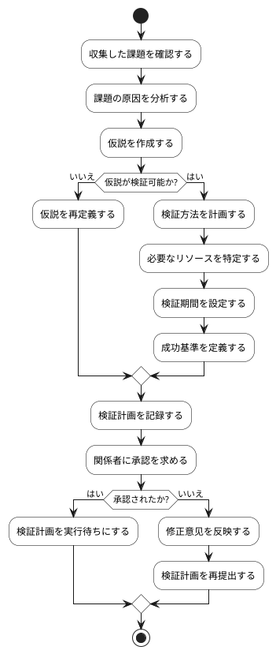

# BUC-DIS-03 仮説作成・検証計画

## 概要

課題に対する仮説を作成し、検証方法を計画する。

## アクティビティ図

## アクティビティ一覧

| 番号   | アクティビティ名 | 説明                             | 担当アクター |
|--------|------------------|----------------------------------|--------------|
| ACT-01 | 課題確認         | 収集した課題を確認               | ACT-02       |
| ACT-02 | 原因分析         | 課題の原因を分析                 | ACT-02       |
| ACT-03 | 仮説作成         | 課題に対する仮説を作成           | ACT-02       |
| ACT-04 | 検証可能性判断   | 仮説が検証可能かどうかを判断     | ACT-02       |
| ACT-05 | 検証方法計画     | 検証方法を計画                   | ACT-02       |
| ACT-06 | リソース特定     | 必要なリソースを特定             | ACT-02       |
| ACT-07 | 期間設定         | 検証期間を設定                   | ACT-02       |
| ACT-08 | 成功基準定義     | 成功基準を定義                   | ACT-02       |
| ACT-09 | 計画記録         | 検証計画を記録                   | ACT-02       |
| ACT-10 | 承認申請         | 関係者に承認を求める             | ACT-02       |
| ACT-11 | 修正反映         | 承認されない場合、修正意见を反映 | ACT-02       |
