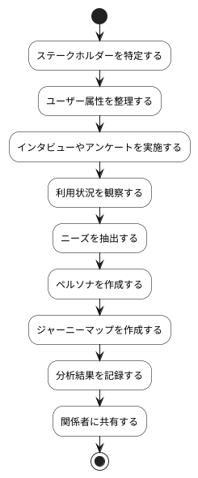

# BUC-DIS-04 ステークホルダー・ユーザー理解

## 概要

関係者やユーザーのニーズ、利用状況を把握・整理する。

## アクティビティ図

## アクティビティ一覧

| 番号   | アクティビティ名     | 説明                           | 担当アクター |
|--------|----------------------|--------------------------------|--------------|
| ACT-01 | ステークホルダー特定 | 関係者を特定                   | ACT-02       |
| ACT-02 | ユーザー属性整理     | ユーザーの属性を整理           | ACT-02       |
| ACT-03 | インタビュー実施     | インタビューやアンケートを実施 | ACT-02       |
| ACT-04 | 利用状況観察         | 実際の利用状況を観察           | ACT-02       |
| ACT-05 | ニーズ抽出           | ニーズを抽出                   | ACT-02       |
| ACT-06 | ペルソナ作成         | ペルソナを作成                 | ACT-02       |
| ACT-07 | ジャーニーマップ作成 | ユーザージャーニーマップを作成 | ACT-02       |
| ACT-08 | 結果記録             | 分析結果を記録                 | ACT-02       |
| ACT-09 | 関係者共有           | 分析結果を関係者に共有         | ACT-02       |
