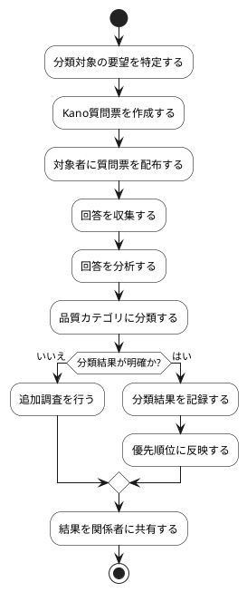

# BUC-DIS-05 Kano評価による要望分類

## 概要

要望についてKano質問票を収集し、品質カテゴリに分類する。

## アクティビティ図

## アクティビティ一覧

| 番号   | アクティビティ名 | 説明                               | 担当アクター   |
|--------|------------------|------------------------------------|----------------|
| ACT-01 | 要望特定         | 分類対象の要望を特定               | ACT-02         |
| ACT-02 | 質問票作成       | Kano質問票を作成                   | ACT-02         |
| ACT-03 | 質問票配布       | 対象者に質問票を配布               | ACT-01, ACT-02 |
| ACT-04 | 回答収集         | 回答を収集                         | ACT-01, ACT-02 |
| ACT-05 | 回答分析         | 回答を分析                         | ACT-02         |
| ACT-06 | カテゴリ分類     | 品質カテゴリに分類                 | ACT-02         |
| ACT-07 | 追加調査         | 分類結果が明確でない場合、追加調査 | ACT-02         |
| ACT-08 | 結果記録         | 分類結果を記録                     | ACT-02         |
| ACT-09 | 優先順位反映     | 分類結果を優先順位に反映           | ACT-02         |
| ACT-10 | 結果共有         | 結果を関係者に共有                 | ACT-02         |
