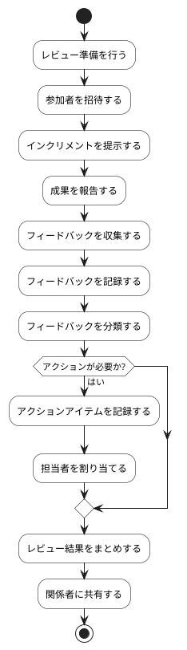

# BUC-LR-01 Sprint Reviewの実施・記録

## 概要

インクリメントと成果を確認し、フィードバックを記録する。

## アクティビティ図

## アクティビティ一覧

| 番号   | アクティビティ名       | 説明                         | 担当アクター                   |
|--------|------------------------|------------------------------|--------------------------------|
| ACT-01 | レビュー準備           | レビュー準備を行う           | ACT-01, ACT-02, ACT-03, ACT-04 |
| ACT-02 | 参加者招待             | 参加者を招待する             | ACT-01, ACT-02, ACT-03, ACT-04 |
| ACT-03 | インクリメント提示     | インクリメントを提示する     | ACT-01, ACT-02, ACT-03, ACT-04 |
| ACT-04 | 成果報告               | 成果を報告する               | ACT-01, ACT-02, ACT-03, ACT-04 |
| ACT-05 | フィードバック収集     | フィードバックを収集する     | ACT-01, ACT-02, ACT-03, ACT-04 |
| ACT-06 | フィードバック記録     | フィードバックを記録する     | ACT-01, ACT-02, ACT-03, ACT-04 |
| ACT-07 | フィードバック分類     | フィードバックを分類する     | ACT-01, ACT-02, ACT-03, ACT-04 |
| ACT-08 | アクションアイテム記録 | アクションアイテムを記録する | ACT-01, ACT-02, ACT-03, ACT-04 |
| ACT-09 | 担当者割り当て         | 担当者を割り当てる           | ACT-01, ACT-02, ACT-03, ACT-04 |
| ACT-10 | レビュー結果まとめ     | レビュー結果をまとめする     | ACT-01, ACT-02, ACT-03, ACT-04 |
| ACT-11 | 関係者共有             | 関係者に共有する             | ACT-01, ACT-02, ACT-03, ACT-04 |
