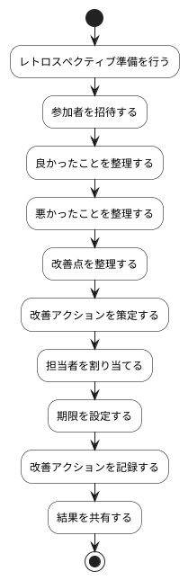

# BUC-LR-02 Sprint Retrospectiveの実施・記録

## 概要

チームの進め方を検査し、改善アクションを記録する。

## アクティビティ図

## アクティビティ一覧

| 番号   | アクティビティ名   | 説明                         | 担当アクター   |
|--------|--------------------|------------------------------|----------------|
| ACT-01 | レトロ準備         | レトロスペクティブ準備を行う | ACT-03, ACT-04 |
| ACT-02 | 参加者招待         | 参加者を招待する             | ACT-03, ACT-04 |
| ACT-03 | 良かったこと整理   | 良かったことを整理する       | ACT-03, ACT-04 |
| ACT-04 | 悪かったこと整理   | 悪かったことを整理する       | ACT-03, ACT-04 |
| ACT-05 | 改善点整理         | 改善点を整理する             | ACT-03, ACT-04 |
| ACT-06 | 改善アクション策定 | 改善アクションを策定する     | ACT-03, ACT-04 |
| ACT-07 | 担当者割り当て     | 担当者を割り当てる           | ACT-03, ACT-04 |
| ACT-08 | 期限設定           | 期限を設定する               | ACT-03, ACT-04 |
| ACT-09 | 改善アクション記録 | 改善アクションを記録する     | ACT-03, ACT-04 |
| ACT-10 | 結果共有           | 結果を共有する               | ACT-03, ACT-04 |
