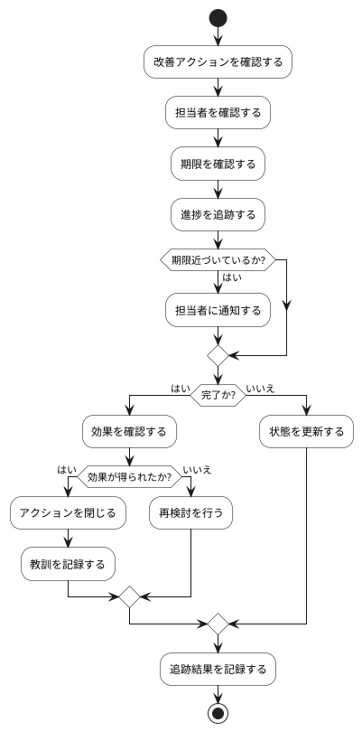

# BUC-LR-03 改善アクションの追跡・効果確認

## 概要

改善の担当・期限・状態を管理し、効果を確かめる。

## アクティビティ図

## アクティビティ一覧

| 番号   | アクティビティ名   | 説明                 | 担当アクター   |
|--------|--------------------|----------------------|----------------|
| ACT-01 | 改善アクション確認 | 改善アクションを確認 | ACT-03, ACT-04 |
| ACT-02 | 担当者確認         | 担当者を確認         | ACT-03, ACT-04 |
| ACT-03 | 期限確認           | 期限を確認           | ACT-03, ACT-04 |
| ACT-04 | 進捗追跡           | 進捗を追跡する       | ACT-03, ACT-04 |
| ACT-05 | 担当者通知         | 担当者に通知する     | ACT-03, ACT-04 |
| ACT-06 | 効果確認           | 効果を確認する       | ACT-03, ACT-04 |
| ACT-07 | アクション閉じる   | アクションを閉じる   | ACT-03, ACT-04 |
| ACT-08 | 教訓記録           | 教訓を記録する       | ACT-03, ACT-04 |
| ACT-09 | 再検討             | 再検討を行う         | ACT-03, ACT-04 |
| ACT-10 | 状態更新           | 状態を更新する       | ACT-03, ACT-04 |
| ACT-11 | 追跡結果記録       | 追跡結果を記録する   | ACT-03, ACT-04 |
