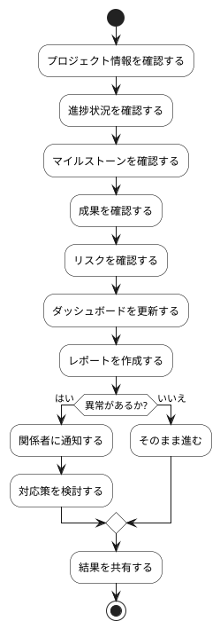

# BUC-LR-04 プロジェクト状況のトラッキング

## 概要

進捗・マイルストーン・成果・リスクを確認・共有する。

## アクティビティ図

## アクティビティ一覧

| 番号   | アクティビティ名     | 説明                       | 担当アクター |
|--------|----------------------|----------------------------|--------------|
| ACT-01 | プロジェクト情報確認 | プロジェクト情報を確認する | ACT-05       |
| ACT-02 | 進捗状況確認         | 進捗状況を確認する         | ACT-05       |
| ACT-03 | マイルストーン確認   | マイルストーンを確認する   | ACT-05       |
| ACT-04 | 成果確認             | 成果を確認する             | ACT-05       |
| ACT-05 | リスク確認           | リスクを確認する           | ACT-05       |
| ACT-06 | ダッシュボード更新   | ダッシュボードを更新する   | ACT-05       |
| ACT-07 | レポート作成         | レポートを作成する         | ACT-05       |
| ACT-08 | 関係者通知           | 関係者に通知する           | ACT-05       |
| ACT-09 | 対応策検討           | 対応策を検討する           | ACT-05       |
| ACT-10 | 結果共有             | 結果を共有する             | ACT-05       |
