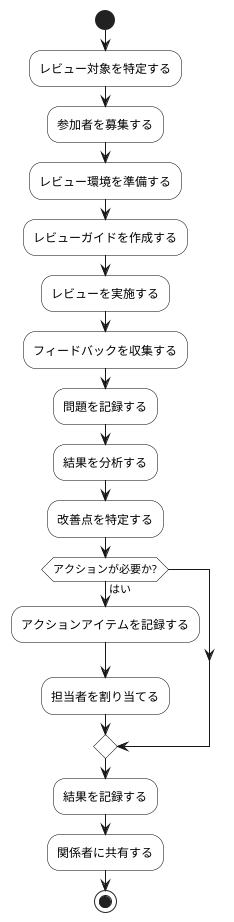

# BUC-LR-05 利用者レビュー・試用の実施

## 概要

対象者にレビュー・試用に参加させ、結果を記録する。

## アクティビティ図

## アクティビティ一覧

| 番号   | アクティビティ名       | 説明                         | 担当アクター   |
|--------|------------------------|------------------------------|----------------|
| ACT-01 | レビュー対象特定       | レビュー対象を特定する       | ACT-01, ACT-02 |
| ACT-02 | 参加者募集             | 参加者を募集する             | ACT-01, ACT-02 |
| ACT-03 | レビュー環境準備       | レビュー環境を準備する       | ACT-01, ACT-02 |
| ACT-04 | レビューガイド作成     | レビューガイドを作成する     | ACT-01, ACT-02 |
| ACT-05 | レビュー実施           | レビューを実施する           | ACT-01, ACT-02 |
| ACT-06 | フィードバック収集     | フィードバックを収集する     | ACT-01, ACT-02 |
| ACT-07 | 問題記録               | 問題を記録する               | ACT-01, ACT-02 |
| ACT-08 | 結果分析               | 結果を分析する               | ACT-01, ACT-02 |
| ACT-09 | 改善点特定             | 改善点を特定する             | ACT-01, ACT-02 |
| ACT-10 | アクションアイテム記録 | アクションアイテムを記録する | ACT-01, ACT-02 |
| ACT-11 | 担当者割り当て         | 担当者を割り当てる           | ACT-01, ACT-02 |
| ACT-12 | 結果記録               | 結果を記録する               | ACT-01, ACT-02 |
| ACT-13 | 関係者共有             | 関係者に共有する             | ACT-01, ACT-02 |
