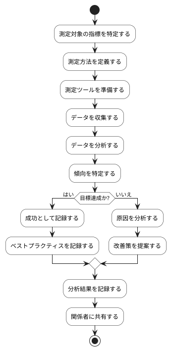

# BUC-LR-06 成果指標の測定・分析

## 概要

リリース後の利用状況や成果指標を測定・分析する。

## アクティビティ図

## アクティビティ一覧

| 番号   | アクティビティ名       | 説明                         | 担当アクター   |
|--------|------------------------|------------------------------|----------------|
| ACT-01 | 指標特定               | 測定対象の指標を特定する     | ACT-02, ACT-05 |
| ACT-02 | 測定方法定義           | 測定方法を定義する           | ACT-02, ACT-05 |
| ACT-03 | 測定ツール準備         | 測定ツールを準備する         | ACT-02, ACT-05 |
| ACT-04 | データ収集             | データを収集する             | ACT-02, ACT-05 |
| ACT-05 | データ分析             | データを分析する             | ACT-02, ACT-05 |
| ACT-06 | 傾向特定               | 傾向を特定する               | ACT-02, ACT-05 |
| ACT-07 | 成功記録               | 成功として記録する           | ACT-02, ACT-05 |
| ACT-08 | ベストプラクティス記録 | ベストプラクティスを記録する | ACT-02, ACT-05 |
| ACT-09 | 原因分析               | 原因を分析する               | ACT-02, ACT-05 |
| ACT-10 | 改善策提案             | 改善策を提案する             | ACT-02, ACT-05 |
| ACT-11 | 分析結果記録           | 分析結果を記録する           | ACT-02, ACT-05 |
| ACT-12 | 関係者共有             | 関係者に共有する             | ACT-02, ACT-05 |
