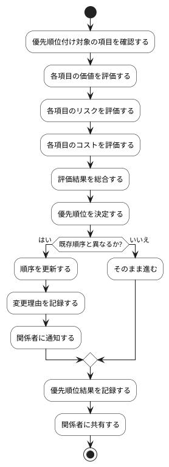

# BUC-PR-01 優先順位の決定・更新

## 概要

価値・リスク・コストを踏まえてバックログ項目の順序を決める。

## アクティビティ図

## アクティビティ一覧

| 番号   | アクティビティ名 | 説明                         | 担当アクター |
|--------|------------------|------------------------------|--------------|
| ACT-01 | 対象項目確認     | 優先順位付け対象の項目を確認 | ACT-02       |
| ACT-02 | 価値評価         | 各項目の価値を評価           | ACT-02       |
| ACT-03 | リスク評価       | 各項目のリスクを評価         | ACT-02       |
| ACT-04 | コスト評価       | 各項目のコストを評価         | ACT-02       |
| ACT-05 | 評価結果総合     | 評価結果を総合               | ACT-02       |
| ACT-06 | 優先順位決定     | 優先順位を決定               | ACT-02       |
| ACT-07 | 順序更新         | 順序を更新                   | ACT-02       |
| ACT-08 | 変更理由記録     | 変更理由を記録               | ACT-02       |
| ACT-09 | 関係者通知       | 関係者に通知                 | ACT-02       |
| ACT-10 | 結果記録         | 優先順位結果を記録           | ACT-02       |
| ACT-11 | 結果共有         | 関係者に共有                 | ACT-02       |
