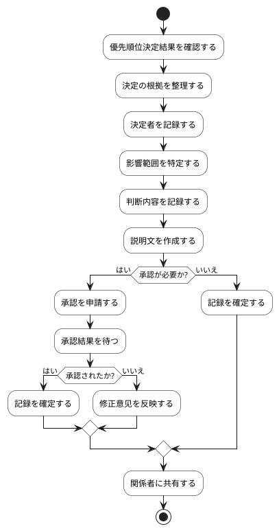

# BUC-PR-03 優先判断の記録・説明

## 概要

優先順位決定の根拠・決定者・影響範囲を記録する。

## アクティビティ図

## アクティビティ一覧

| 番号   | アクティビティ名 | 説明                             | 担当アクター |
|--------|------------------|----------------------------------|--------------|
| ACT-01 | 決定結果確認     | 優先順位決定結果を確認           | ACT-02       |
| ACT-02 | 根拠整理         | 決定の根拠を整理                 | ACT-02       |
| ACT-03 | 決定者記録       | 決定者を記録                     | ACT-02       |
| ACT-04 | 影響範囲特定     | 影響範囲を特定                   | ACT-02       |
| ACT-05 | 判断内容記録     | 判断内容を記録                   | ACT-02       |
| ACT-06 | 説明文作成       | 説明文を作成                     | ACT-02       |
| ACT-07 | 承認申請         | 承認を申請                       | ACT-02       |
| ACT-08 | 承認結果待機     | 承認結果を待つ                   | ACT-02       |
| ACT-09 | 記録確定         | 記録を確定                       | ACT-02       |
| ACT-10 | 修正反映         | 承認されない場合、修正意见を反映 | ACT-02       |
| ACT-11 | 関係者共有       | 関係者に共有                     | ACT-02       |
