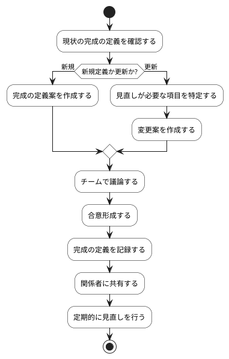

# BUC-QL-01 完成の定義の管理

## 概要

チームの品質基準を定義・共有・更新する。

## アクティビティ図

## アクティビティ一覧

| 番号   | アクティビティ名 | 説明                         | 担当アクター   |
|--------|------------------|------------------------------|----------------|
| ACT-01 | 現状確認         | 現状の完成の定義を確認       | ACT-03, ACT-04 |
| ACT-02 | 定義案作成       | 新規または更新の定義案を作成 | ACT-03, ACT-04 |
| ACT-03 | チーム議論       | チームで議論                 | ACT-03, ACT-04 |
| ACT-04 | 合意形成         | 合意形成                     | ACT-03, ACT-04 |
| ACT-05 | 定義記録         | 完成の定義を記録             | ACT-03, ACT-04 |
| ACT-06 | 関係者共有       | 関係者に共有                 | ACT-03, ACT-04 |
| ACT-07 | 定期的見直し     | 定期的に見直しを行う         | ACT-03, ACT-04 |
