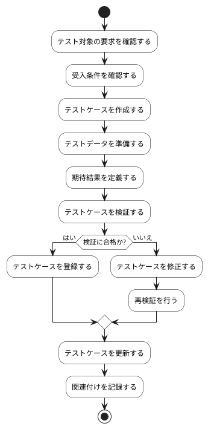

# BUC-QL-02 テストケースの作成・管理

## 概要

要求や受入条件に関連づけたテストケースを管理する。

## アクティビティ図

## アクティビティ一覧

| 番号   | アクティビティ名 | 説明                   | 担当アクター   |
|--------|------------------|------------------------|----------------|
| ACT-01 | 要求確認         | テスト対象の要求を確認 | ACT-02, ACT-04 |
| ACT-02 | 受入条件確認     | 受入条件を確認         | ACT-02, ACT-04 |
| ACT-03 | テストケース作成 | テストケースを作成     | ACT-02, ACT-04 |
| ACT-04 | テストデータ準備 | テストデータを準備     | ACT-02, ACT-04 |
| ACT-05 | 期待結果定義     | 期待結果を定義         | ACT-02, ACT-04 |
| ACT-06 | テストケース検証 | テストケースを検証     | ACT-02, ACT-04 |
| ACT-07 | テストケース修正 | テストケースを修正     | ACT-02, ACT-04 |
| ACT-08 | テストケース登録 | テストケースを登録     | ACT-02, ACT-04 |
| ACT-09 | テストケース更新 | テストケースを更新     | ACT-02, ACT-04 |
| ACT-10 | 関連付け記録     | 関連付けを記録         | ACT-02, ACT-04 |
