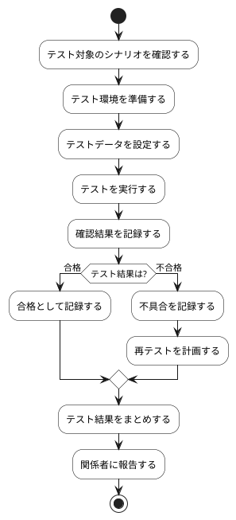

# BUC-QL-03 受入テスト・シナリオ検証

## 概要

業務シナリオに沿った期待結果と確認結果を記録する。

## アクティビティ図

## アクティビティ一覧

| 番号   | アクティビティ名 | 説明                       | 担当アクター           |
|--------|------------------|----------------------------|------------------------|
| ACT-01 | シナリオ確認     | テスト対象のシナリオを確認 | ACT-01, ACT-02, ACT-04 |
| ACT-02 | テスト環境準備   | テスト環境を準備           | ACT-04                 |
| ACT-03 | テストデータ設定 | テストデータを設定         | ACT-04                 |
| ACT-04 | テスト実行       | テストを実行               | ACT-01, ACT-02, ACT-04 |
| ACT-05 | 確認結果記録     | 確認結果を記録             | ACT-01, ACT-02, ACT-04 |
| ACT-06 | 合格記録         | 合格として記録             | ACT-04                 |
| ACT-07 | 不具合記録       | 不具合を記録               | ACT-04                 |
| ACT-08 | 再テスト計画     | 再テストを計画             | ACT-04                 |
| ACT-09 | テスト結果まとめ | テスト結果をまとめする     | ACT-04                 |
| ACT-10 | 関係者報告       | 関係者に報告               | ACT-01, ACT-02, ACT-04 |
