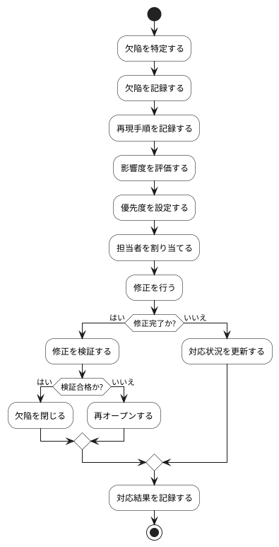

# BUC-QL-04 欠陥の記録・対応

## 概要

再現手順・影響度・状態を管理し、対応を追跡する。

## アクティビティ図

## アクティビティ一覧

| 番号   | アクティビティ名 | 説明                         | 担当アクター           |
|--------|------------------|------------------------------|------------------------|
| ACT-01 | 欠陥特定         | 欠陥を特定                   | ACT-01, ACT-02, ACT-04 |
| ACT-02 | 欠陥記録         | 欠陥を記録                   | ACT-01, ACT-02, ACT-04 |
| ACT-03 | 再現手順記録     | 再現手順を記録               | ACT-04                 |
| ACT-04 | 影響度評価       | 影響度を評価                 | ACT-04                 |
| ACT-05 | 優先度設定       | 優先度を設定                 | ACT-04                 |
| ACT-06 | 担当者割り当て   | 担当者を割り当てる           | ACT-04                 |
| ACT-07 | 修正             | 修正を行う                   | ACT-04                 |
| ACT-08 | 修正検証         | 修正を検証                   | ACT-04                 |
| ACT-09 | 欠陥閉じる       | 欠陥を閉じる                 | ACT-04                 |
| ACT-10 | 再オープン       | 検証不合格の場合、再オープン | ACT-04                 |
| ACT-11 | 対応状況更新     | 対応状況を更新               | ACT-04                 |
| ACT-12 | 対応結果記録     | 対応結果を記録               | ACT-04                 |
