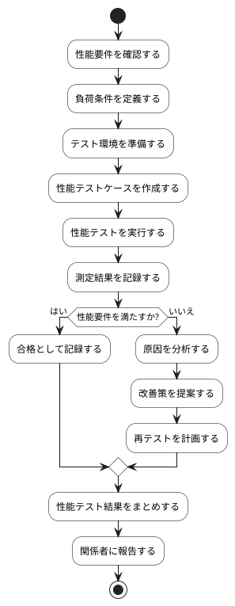

# BUC-QL-05 性能検証

## 概要

性能要件・負荷条件を満たすか検証する。

## アクティビティ図

## アクティビティ一覧

| 番号   | アクティビティ名 | 説明                                 | 担当アクター |
|--------|------------------|--------------------------------------|--------------|
| ACT-01 | 性能要件確認     | 性能要件を確認                       | ACT-04       |
| ACT-02 | 負荷条件定義     | 負荷条件を定義                       | ACT-04       |
| ACT-03 | テスト環境準備   | テスト環境を準備                     | ACT-04       |
| ACT-04 | テストケース作成 | 性能テストケースを作成               | ACT-04       |
| ACT-05 | テスト実行       | 性能テストを実行                     | ACT-04       |
| ACT-06 | 測定結果記録     | 測定結果を記録                       | ACT-04       |
| ACT-07 | 合格記録         | 合格として記録                       | ACT-04       |
| ACT-08 | 原因分析         | 性能要件を満たさない場合、原因を分析 | ACT-04       |
| ACT-09 | 改善策提案       | 改善策を提案                         | ACT-04       |
| ACT-10 | 再テスト計画     | 再テストを計画                       | ACT-04       |
| ACT-11 | テスト結果まとめ | 性能テスト結果をまとめする           | ACT-04       |
| ACT-12 | 関係者報告       | 関係者に報告                         | ACT-04       |
