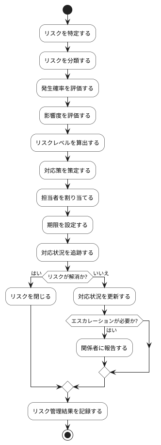

# BUC-QL-06 セキュリティ・品質リスク管理

## 概要

品質・セキュリティ上のリスクと対応を記録する。

## アクティビティ図

## アクティビティ一覧

| 番号   | アクティビティ名 | 説明                 | 担当アクター   |
|--------|------------------|----------------------|----------------|
| ACT-01 | リスク特定       | リスクを特定         | ACT-04, ACT-06 |
| ACT-02 | リスク分類       | リスクを分類         | ACT-04, ACT-06 |
| ACT-03 | 発生確率評価     | 発生確率を評価       | ACT-04, ACT-06 |
| ACT-04 | 影響度評価       | 影響度を評価         | ACT-04, ACT-06 |
| ACT-05 | リスクレベル算出 | リスクレベルを算出   | ACT-04, ACT-06 |
| ACT-06 | 対応策策定       | 対応策を策定         | ACT-04, ACT-06 |
| ACT-07 | 担当者割り当て   | 担当者を割り当てる   | ACT-04, ACT-06 |
| ACT-08 | 期限設定         | 期限を設定           | ACT-04, ACT-06 |
| ACT-09 | 対応状況追跡     | 対応状況を追跡       | ACT-04, ACT-06 |
| ACT-10 | リスク閉じる     | リスクを閉じる       | ACT-04, ACT-06 |
| ACT-11 | 対応状況更新     | 対応状況を更新       | ACT-04, ACT-06 |
| ACT-12 | エスカレーション | 関係者に報告         | ACT-04, ACT-06 |
| ACT-13 | 結果記録         | リスク管理結果を記録 | ACT-04, ACT-06 |
