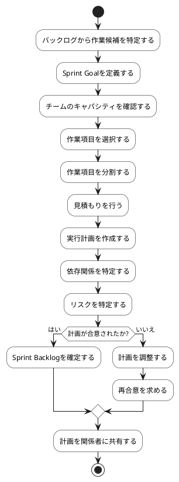

# BUC-SP-01 スプリント計画の作成

## 概要

Sprint Goalと作業候補を確認し、Sprint Backlogと実行計画を作る。

## アクティビティ図

## アクティビティ一覧

| 番号   | アクティビティ名   | 説明                         | 担当アクター           |
|--------|--------------------|------------------------------|------------------------|
| ACT-01 | 作業候補特定       | バックログから作業候補を特定 | ACT-02, ACT-03, ACT-04 |
| ACT-02 | Sprint Goal定義    | Sprint Goalを定義            | ACT-02, ACT-03, ACT-04 |
| ACT-03 | キャパシティ確認   | チームのキャパシティを確認   | ACT-02, ACT-03, ACT-04 |
| ACT-04 | 作業項目選択       | 作業項目を選択               | ACT-02, ACT-03, ACT-04 |
| ACT-05 | 作業項目分割       | 作業項目を分割               | ACT-02, ACT-03, ACT-04 |
| ACT-06 | 見積もり           | 見積もりを行う               | ACT-02, ACT-03, ACT-04 |
| ACT-07 | 実行計画作成       | 実行計画を作成               | ACT-02, ACT-03, ACT-04 |
| ACT-08 | 依存関係特定       | 依存関係を特定               | ACT-02, ACT-03, ACT-04 |
| ACT-09 | リスク特定         | リスクを特定                 | ACT-02, ACT-03, ACT-04 |
| ACT-10 | Sprint Backlog確定 | Sprint Backlogを確定         | ACT-02, ACT-03, ACT-04 |
| ACT-11 | 計画調整           | 計画を調整                   | ACT-02, ACT-03, ACT-04 |
| ACT-12 | 計画共有           | 計画を関係者に共有           | ACT-02, ACT-03, ACT-04 |
