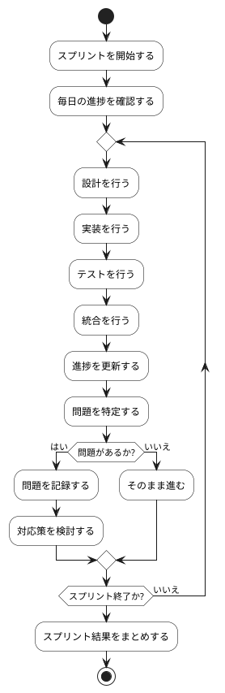

# BUC-SP-02 スプリント実行・日々の適応

## 概要

設計・実装・テスト・統合を行い、日々計画を調整する。

## アクティビティ図

## アクティビティ一覧

| 番号   | アクティビティ名     | 説明                       | 担当アクター |
|--------|----------------------|----------------------------|--------------|
| ACT-01 | スプリント開始       | スプリントを開始する       | ACT-04       |
| ACT-02 | 進捗確認             | 毎日の進捗を確認           | ACT-04       |
| ACT-03 | 設計                 | 設計を行う                 | ACT-04       |
| ACT-04 | 実装                 | 実装を行う                 | ACT-04       |
| ACT-05 | テスト               | テストを行う               | ACT-04       |
| ACT-06 | 統合                 | 統合を行う                 | ACT-04       |
| ACT-07 | 進捗更新             | 進捗を更新する             | ACT-04       |
| ACT-08 | 問題特定             | 問題を特定する             | ACT-04       |
| ACT-09 | 問題記録             | 問題を記録する             | ACT-04       |
| ACT-10 | 対応策検討           | 対応策を検討する           | ACT-04       |
| ACT-11 | スプリント結果まとめ | スプリント結果をまとめする | ACT-04       |
