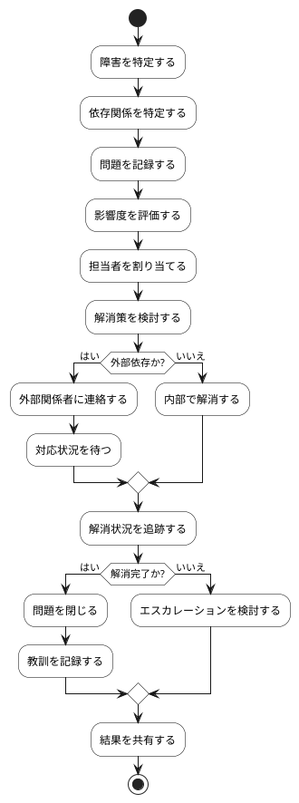

# BUC-SP-03 障害・依存関係の解消

## 概要

進行を妨げる問題を可視化し、解消を支援する。

## アクティビティ図

## アクティビティ一覧

| 番号   | アクティビティ名 | 説明                   | 担当アクター   |
|--------|------------------|------------------------|----------------|
| ACT-01 | 障害特定         | 障害を特定             | ACT-03, ACT-04 |
| ACT-02 | 依存関係特定     | 依存関係を特定         | ACT-03, ACT-04 |
| ACT-03 | 問題記録         | 問題を記録             | ACT-03, ACT-04 |
| ACT-04 | 影響度評価       | 影響度を評価           | ACT-03, ACT-04 |
| ACT-05 | 担当者割り当て   | 担当者を割り当てる     | ACT-03, ACT-04 |
| ACT-06 | 解消策検討       | 解消策を検討           | ACT-03, ACT-04 |
| ACT-07 | 外部関係者連絡   | 外部関係者に連絡       | ACT-03, ACT-04 |
| ACT-08 | 内部解消         | 内部で解消する         | ACT-03, ACT-04 |
| ACT-09 | 解消状況追跡     | 解消状況を追跡         | ACT-03, ACT-04 |
| ACT-10 | 問題閉じる       | 問題を閉じる           | ACT-03, ACT-04 |
| ACT-11 | 教訓記録         | 教訓を記録             | ACT-03, ACT-04 |
| ACT-12 | エスカレーション | エスカレーションを検討 | ACT-03, ACT-04 |
| ACT-13 | 結果共有         | 結果を共有             | ACT-03, ACT-04 |
