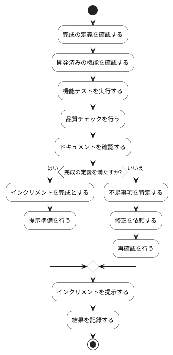

# BUC-SP-05 インクリメントの完成確認

## 概要

完成の定義を満たすインクリメントを確認・提示する。

## アクティビティ図

## アクティビティ一覧

| 番号   | アクティビティ名   | 説明                       | 担当アクター |
|--------|--------------------|----------------------------|--------------|
| ACT-01 | 完成の定義確認     | 完成の定義を確認           | ACT-04       |
| ACT-02 | 機能確認           | 開発済みの機能を確認       | ACT-04       |
| ACT-03 | 機能テスト実行     | 機能テストを実行           | ACT-04       |
| ACT-04 | 品質チェック       | 品質チェックを行う         | ACT-04       |
| ACT-05 | ドキュメント確認   | ドキュメントを確認         | ACT-04       |
| ACT-06 | インクリメント完成 | インクリメントを完成とする | ACT-04       |
| ACT-07 | 提示準備           | 提示準備を行う             | ACT-04       |
| ACT-08 | 不足事項特定       | 不足事項を特定             | ACT-04       |
| ACT-09 | 修正依頼           | 修正を依頼                 | ACT-04       |
| ACT-10 | 再確認             | 再確認を行う               | ACT-04       |
| ACT-11 | インクリメント提示 | インクリメントを提示する   | ACT-04       |
| ACT-12 | 結果記録           | 結果を記録                 | ACT-04       |
