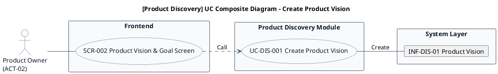
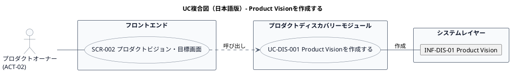

# UC複合図

AG-01 プロダクトディスカバリー業務領域で扱うユースケース、画面、イベント、情報、条件を関連づけた図です。

## 1. 目的

本書は、AG-01 プロダクトディスカバリー業務領域のシステム境界レイヤーで扱うユースケース「Product
Visionを作成する」に関するUC複合図です。

## 2. PlantUML UC複合図（英語版）

## 3. 日本語版 UC複合図

## 4. ユースケース一覧

| ユースケースID | ユースケース名           | 英語名              | 説明                                                     | 関連アクター              |
|----------------|--------------------------|---------------------|----------------------------------------------------------|---------------------------|
| UC-DIS-001     | Product Visionを作成する | CreateProductVision | プロダクトの対象者、課題、目指す将来像を定義して登録する | ACT-02 プロダクトオーナー |

## 5. 画面一覧

| 画面ID  | 画面名                   | 英語名                     | 説明                                             | 関連ユースケース |
|---------|--------------------------|----------------------------|--------------------------------------------------|------------------|
| SCR-002 | プロダクトビジョン・目標 | ProductVisionAndGoalScreen | ビジョン、Product Goal、成功指標、仮説を管理する | UC-DIS-001       |

## 6. イベント一覧

| イベントID  | イベント名                 | 英語名               | 説明                                               | 関連ユースケース |
|-------------|----------------------------|----------------------|----------------------------------------------------|------------------|
| EVT-DIS-001 | Product Visionが作成された | ProductVisionCreated | プロダクトの対象者、課題、目指す将来像が定義された | UC-DIS-001       |

## 7. 情報一覧

| 情報ID     | 情報名         | 英語名        | 説明                                   | 関連ユースケース |
|------------|----------------|---------------|----------------------------------------|------------------|
| INF-DIS-01 | Product Vision | ProductVision | プロダクトの対象者、課題、目指す将来像 | UC-DIS-001       |

## 8. 条件一覧

条件なし

## 9. 参照情報

- ユースケース一覧: `01.ユースケース/ユースケース一覧.md`
- 画面一覧: `04.システム/04.画面/画面一覧.md`
- イベント一覧: `04.システム/03.イベント/イベント一覧.md`
- 情報一覧: `04.システム/01.情報/情報一覧.md`
