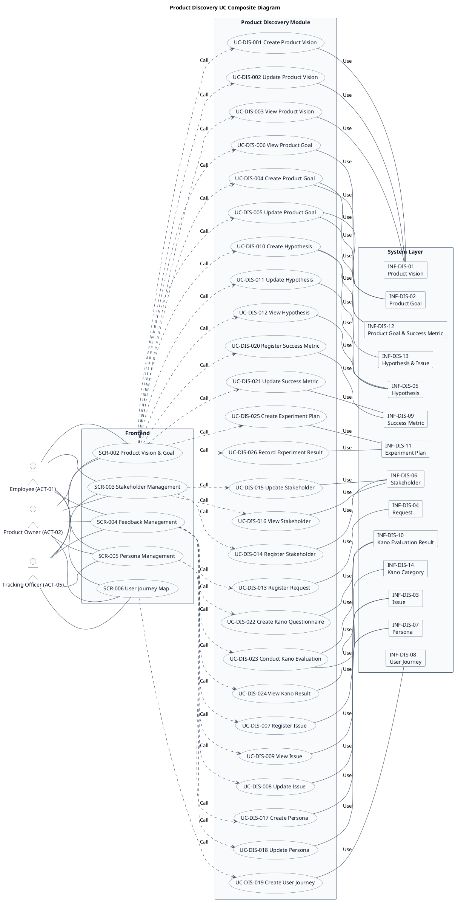
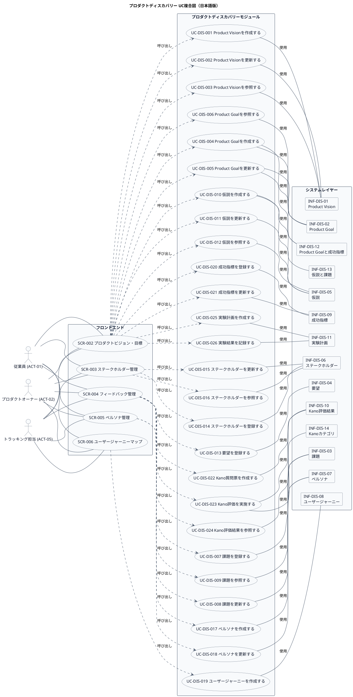

# UC複合図

プロダクトディスカバリー業務領域で扱うユースケース、画面、イベント、情報などを関連づけたUC複合図です。

## 1. 目的

本書は、AG-01 プロダクトディスカバリー業務領域のシステム境界レイヤーで扱うユースケース、画面、イベント、情報、条件を関連づけたUC複合図です。

## 2. PlantUML UC複合図（英語版）

## 3. 日本語版 UC複合図

## 4. ユースケース一覧

| ユースケースID | ユースケース名               | 英語名                        | 説明                                                         | 関連アクター               |
|----------------|------------------------------|-------------------------------|--------------------------------------------------------------|----------------------------|
| UC-DIS-001     | Product Visionを作成する     | Create Product Vision         | プロダクトの対象者、課題、目指す将来像を定義して登録する     | ACT-02                     |
| UC-DIS-002     | Product Visionを更新する     | Update Product Vision         | 既存のProduct Visionを修正・更新する                         | ACT-02                     |
| UC-DIS-003     | Product Visionを参照する     | View Product Vision           | 現在のProduct Visionの内容を確認する                         | ACT-01, ACT-02, ACT-05     |
| UC-DIS-004     | Product Goalを作成する       | Create Product Goal           | プロダクト目標、期間、状態、関連指標を定義して登録する       | ACT-02                     |
| UC-DIS-005     | Product Goalを更新する       | Update Product Goal           | 既存のProduct Goalの期間・状態・指標を修正・更新する         | ACT-02                     |
| UC-DIS-006     | Product Goalを参照する       | View Product Goal             | 現在のProduct Goalの内容と進捗状況を確認する                 | ACT-01, ACT-02, ACT-05     |
| UC-DIS-007     | 課題を登録する               | Register Issue                | 業務上の困りごとや繰り返し発生する問題を背景とともに記録する | ACT-01, ACT-02             |
| UC-DIS-008     | 課題を更新する               | Update Issue                  | 既存の課題の詳細・影響・状態を修正する                       | ACT-01, ACT-02             |
| UC-DIS-009     | 課題を参照する               | View Issue                    | 登録された課題の一覧・詳細を確認する                         | ACT-01, ACT-02, ACT-05     |
| UC-DIS-010     | 仮説を作成する               | Create Hypothesis             | 課題に対する検証可能な仮説と検証方法を定義する               | ACT-02                     |
| UC-DIS-011     | 仮説を更新する               | Update Hypothesis             | 仮説の検証方法・結果・学びを修正・更新する                   | ACT-02                     |
| UC-DIS-012     | 仮説を参照する               | View Hypothesis               | 登録された仮説の一覧・詳細を確認する                         | ACT-01, ACT-02, ACT-05     |
| UC-DIS-013     | 要望を登録する               | Register Request              | 顧客や利用者から受けた意見・要望を記録する                   | ACT-01, ACT-02             |
| UC-DIS-014     | ステークホルダーを登録する   | Register Stakeholder          | 関係者、関心事、影響範囲、連絡方法を整理して登録する         | ACT-02                     |
| UC-DIS-015     | ステークホルダーを更新する   | Update Stakeholder            | 既存のステークホルダー情報を修正する                         | ACT-02                     |
| UC-DIS-016     | ステークホルダーを参照する   | View Stakeholder              | 登録されたステークホルダーの一覧・詳細を確認する             | ACT-01, ACT-02, ACT-05     |
| UC-DIS-017     | ペルソナを作成する           | Create Persona                | ユーザー像、ニーズ、利用状況を定義して登録する               | ACT-02                     |
| UC-DIS-018     | ペルソナを更新する           | Update Persona                | 既存のペルソナ情報を修正する                                 | ACT-02                     |
| UC-DIS-019     | ユーザージャーニーを作成する | Create User Journey           | 利用者の行動、課題、感情、機会を可視化する                   | ACT-02                     |
| UC-DIS-020     | 成功指標を登録する           | Register Success Metric       | 指標の定義、基準値、目標値、データ元、更新頻度を設定する     | ACT-02                     |
| UC-DIS-021     | 成功指標を更新する           | Update Success Metric         | 既存の成功指標の値・目標値を修正する                         | ACT-02                     |
| UC-DIS-022     | Kano質問票を作成する         | Create Kano Questionnaire     | 各要望について機能がある場合・ない場合の反応を対で定義する   | ACT-02                     |
| UC-DIS-023     | Kano評価を実施する           | Conduct Kano Evaluation       | Kano質問票に基づいて回答を収集し、品質カテゴリに分類する     | ACT-01, ACT-02             |
| UC-DIS-024     | Kano評価結果を参照する       | View Kano Evaluation Result   | 要望のKano分類結果を確認する                                 | ACT-01, ACT-02, ACT-05     |
| UC-DIS-025     | 実験計画を作成する           | Create Experiment Plan        | 実験計画、結果、学びを仮説や目標と関連づけて登録する         | ACT-02                     |
| UC-DIS-026     | 実験結果を記録する           | Record Experiment Result      | 実験の実施結果と得られた学びを記録する                       | ACT-02                     |

## 5. 画面一覧

| 画面ID  | 画面名                   | 英語名                     | 主な利用者           | 関連ユースケース |
|---------|--------------------------|----------------------------|----------------------|------------------|
| SCR-002 | プロダクトビジョン・目標 | Product Vision & Goal      | PO、ステークホルダー | UC-DIS-001〜006, 010〜012, 020〜021, 025〜026 |
| SCR-003 | ステークホルダー管理     | Stakeholder Management     | PO、管理者           | UC-DIS-014〜016  |
| SCR-004 | フィードバック管理       | Feedback Management        | PO、ステークホルダー | UC-DIS-007〜009, 013, 022〜024 |
| SCR-005 | ペルソナ管理             | Persona Management         | PO、UX担当           | UC-DIS-017〜018  |
| SCR-006 | ユーザージャーニーマップ | User Journey Map           | PO、UX担当、チーム   | UC-DIS-019       |

## 6. イベント一覧

| イベントID  | イベント名                     | 英語名                          | 説明                                                         | 関連ユースケース |
|-------------|--------------------------------|---------------------------------|--------------------------------------------------------------|------------------|
| EVT-DIS-001 | Product Visionが作成された     | Product Vision Created          | プロダクトの対象者、課題、目指す将来像が定義された           | UC-DIS-001       |
| EVT-DIS-002 | Product Visionが更新された     | Product Vision Updated          | 既存のProduct Visionが修正・更新された                       | UC-DIS-002       |
| EVT-DIS-003 | Product Goalが作成された       | Product Goal Created            | プロダクト目標、期間、状態、関連指標が定義された             | UC-DIS-004       |
| EVT-DIS-004 | Product Goalが更新された       | Product Goal Updated            | 既存のProduct Goalの期間・状態・指標が修正された             | UC-DIS-005       |
| EVT-DIS-005 | 課題が登録された               | Issue Registered                | 業務上の困りごとや繰り返し発生する問題が記録された           | UC-DIS-007       |
| EVT-DIS-006 | 課題が更新された               | Issue Updated                   | 既存の課題の詳細・影響・状態が修正された                     | UC-DIS-008       |
| EVT-DIS-007 | 仮説が作成された               | Hypothesis Created              | 課題に対する検証可能な仮説と検証方法が定義された             | UC-DIS-010       |
| EVT-DIS-008 | 仮説が更新された               | Hypothesis Updated              | 仮説の検証方法・結果・学びが修正された                       | UC-DIS-011       |
| EVT-DIS-009 | 要望が登録された               | Request Registered              | 顧客や利用者から受けた意見・要望が記録された                 | UC-DIS-013       |
| EVT-DIS-010 | ステークホルダーが登録された   | Stakeholder Registered          | 関係者、関心事、影響範囲、連絡方法が整理された               | UC-DIS-014       |
| EVT-DIS-011 | ステークホルダーが更新された   | Stakeholder Updated             | 既存のステークホルダー情報が修正された                       | UC-DIS-015       |
| EVT-DIS-012 | ペルソナが作成された           | Persona Created                 | ユーザー像、ニーズ、利用状況が定義された                     | UC-DIS-017       |
| EVT-DIS-013 | ペルソナが更新された           | Persona Updated                 | 既存のペルソナ情報が修正された                               | UC-DIS-018       |
| EVT-DIS-014 | ユーザージャーニーが作成された | User Journey Created            | 利用者の行動、課題、感情、機会が可視化された                 | UC-DIS-019       |
| EVT-DIS-015 | 成功指標が登録された           | Success Metric Registered       | 指標の定義、基準値、目標値、データ元、更新頻度が設定された   | UC-DIS-020       |
| EVT-DIS-016 | 成功指標が更新された           | Success Metric Updated          | 既存の成功指標の値・目標値が修正された                       | UC-DIS-021       |
| EVT-DIS-017 | Kano質問票が作成された         | Kano Questionnaire Created      | 各要望について機能がある場合・ない場合の反応が対で定義された | UC-DIS-022       |
| EVT-DIS-018 | Kano評価が完了した             | Kano Evaluation Completed       | Kano質問票に基づいて回答が収集され、品質カテゴリに分類された | UC-DIS-023       |
| EVT-DIS-019 | 実験計画が作成された           | Experiment Plan Created         | 実験計画、結果、学びが仮説や目標と関連づけて登録された       | UC-DIS-025       |
| EVT-DIS-020 | 実験結果が記録された           | Experiment Result Recorded      | 実験の実施結果と得られた学びが記録された                     | UC-DIS-026       |

## 7. 情報一覧

| 情報ID     | 情報名                 | 英語名                      | 情報種類 | 説明                                                   | 関連ユースケース |
|------------|------------------------|-----------------------------|----------|--------------------------------------------------------|------------------|
| INF-DIS-01 | Product Vision         | Product Vision              | リソース | プロダクトの対象者、課題、目指す将来像                 | UC-DIS-001〜003  |
| INF-DIS-02 | Product Goal           | Product Goal                | リソース | プロダクト目標、期間、状態                             | UC-DIS-004〜006  |
| INF-DIS-03 | 課題                   | Issue                       | リソース | 業務上の困りごとや繰り返し発生する問題                 | UC-DIS-007〜009  |
| INF-DIS-04 | 要望                   | Request                     | リソース | 顧客や利用者から受けた意見                             | UC-DIS-013       |
| INF-DIS-05 | 仮説                   | Hypothesis                  | リソース | 課題に対する検証可能な仮説                             | UC-DIS-010〜012  |
| INF-DIS-06 | ステークホルダー       | Stakeholder                 | リソース | 関係者、関心事、影響範囲                               | UC-DIS-014〜016  |
| INF-DIS-07 | ペルソナ               | Persona                     | リソース | ユーザー像、ニーズ、利用状況                           | UC-DIS-017〜018  |
| INF-DIS-08 | ユーザージャーニー     | User Journey                | リソース | 利用者の行動、課題、感情、機会                         | UC-DIS-019       |
| INF-DIS-09 | 成功指標               | Success Metric              | リソース | 指標の定義、基準値、目標値                             | UC-DIS-020〜021  |
| INF-DIS-10 | Kano評価結果           | Kano Evaluation Result      | リソース | 要望のKano分類結果                                     | UC-DIS-022〜024  |
| INF-DIS-11 | 実験計画               | Experiment Plan             | リソース | 実験計画、結果、学び                                   | UC-DIS-025〜026  |
| INF-DIS-12 | Product Goalと成功指標 | Product Goal & Success Metric | 対応表 | 目標と指標の関連                                       | UC-DIS-004〜006  |
| INF-DIS-13 | 仮説と課題             | Hypothesis & Issue          | 対応表   | 仮説と関連する課題の関連                               | UC-DIS-010〜012  |
| INF-DIS-14 | Kanoカテゴリ           | Kano Category               | 対照表   | 当たり前品質、一元品質、魅力的品質、無関心品質、逆品質 | UC-DIS-023       |

## 8. 参照情報

- ユースケース一覧: `01.ユースケース/ユースケース一覧.md`
- 画面一覧: `04.システム/04.画面/画面一覧.md`
- イベント一覧: `04.システム/03.イベント/イベント一覧.md`
- 情報一覧: `04.システム/01.情報/情報一覧.md`
