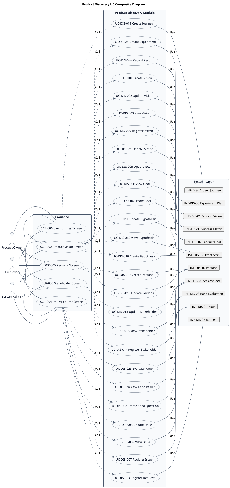
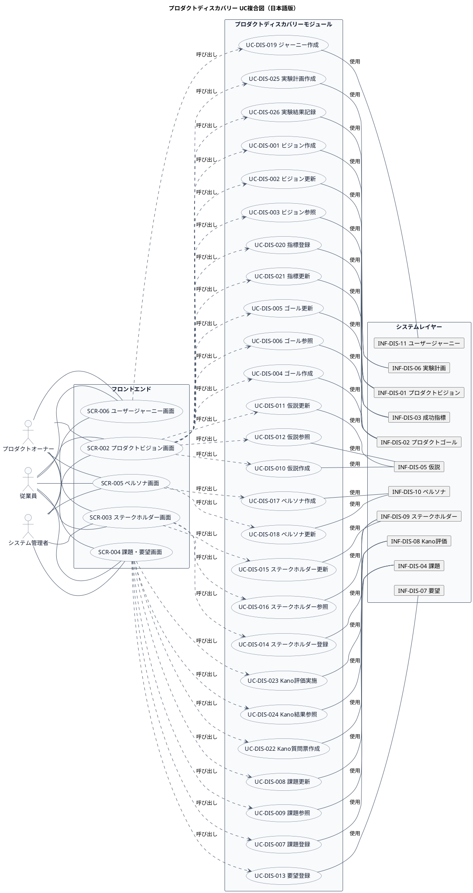

# UC複合図

プロダクトディスカバリー業務領域で扱うユースケース、画面、イベント、情報、条件を関連づけた図です。

## 1. 目的

本書は、AG-01 プロダクトディスカバリー
業務領域のシステム境界レイヤーで扱うユースケース、画面、イベント、情報、条件を関連づけたUC複合図です。

## 2. PlantUML UC複合図（英語版）

## 3. 日本語版 UC複合図

## 4. ユースケース一覧

| ユースケースID | ユースケース名 | 英語名      | 説明 | 関連アクター |
|----------------|----------------|-------------|------|--------------|
| UC-DIS-001 | Product Visionを作成する | CreateVision | プロダクトビジョンを定義して登録する | 従業員 |
| UC-DIS-002 | Product Visionを更新する | UpdateVision | 既存のビジョンを修正・更新する | 従業員 |
| UC-DIS-003 | Product Visionを参照する | ViewVision | 現在のビジョンの内容を確認する | プロダクトオーナー、従業員、システム管理者 |
| UC-DIS-004 | Product Goalを作成する | CreateGoal | プロダクト目標を定義して登録する | 従業員 |
| UC-DIS-005 | Product Goalを更新する | UpdateGoal | 既存のゴールを修正・更新する | 従業員 |
| UC-DIS-006 | Product Goalを参照する | ViewGoal | 現在のゴールの内容を確認する | プロダクトオーナー、従業員、システム管理者 |
| UC-DIS-007 | 課題を登録する | RegisterIssue | 業務上の課題を記録する | プロダクトオーナー、従業員 |
| UC-DIS-008 | 課題を更新する | UpdateIssue | 既存の課題を修正する | プロダクトオーナー、従業員 |
| UC-DIS-009 | 課題を参照する | ViewIssue | 登録された課題を確認する | プロダクトオーナー、従業員、システム管理者 |
| UC-DIS-010 | 仮説を作成する | CreateHypothesis | 仮説と検証方法を定義する | 従業員 |
| UC-DIS-011 | 仮説を更新する | UpdateHypothesis | 仮説を修正・更新する | 従業員 |
| UC-DIS-012 | 仮説を参照する | ViewHypothesis | 登録された仮説を確認する | プロダクトオーナー、従業員、システム管理者 |
| UC-DIS-013 | 要望を登録する | RegisterRequest | 顧客・利用者からの要望を記録する | プロダクトオーナー、従業員 |
| UC-DIS-014 | ステークホルダーを登録する | RegisterStakeholder | 関係者情報を整理して登録する | 従業員 |
| UC-DIS-015 | ステークホルダーを更新する | UpdateStakeholder | 既存のステークホルダー情報を修正する | 従業員 |
| UC-DIS-016 | ステークホルダーを参照する | ViewStakeholder | 登録されたステークホルダーを確認する | プロダクトオーナー、従業員、システム管理者 |
| UC-DIS-017 | ペルソナを作成する | CreatePersona | ユーザー像を定義して登録する | 従業員 |
| UC-DIS-018 | ペルソナを更新する | UpdatePersona | 既存のペルソナ情報を修正する | 従業員 |
| UC-DIS-019 | ユーザージャーニーを作成する | CreateJourney | 利用者の行動を可視化する | 従業員 |
| UC-DIS-020 | 成功指標を登録する | RegisterMetric | 指標の定義を設定する | 従業員 |
| UC-DIS-021 | 成功指標を更新する | UpdateMetric | 既存の指標を修正する | 従業員 |
| UC-DIS-022 | Kano質問票を作成する | CreateKanoQuestion | Kano質問票を定義する | 従業員 |
| UC-DIS-023 | Kano評価を実施する | EvaluateKano | Kano評価を実施して分類する | プロダクトオーナー、従業員 |
| UC-DIS-024 | Kano評価結果を参照する | ViewKanoResult | Kano分類結果を確認する | プロダクトオーナー、従業員、システム管理者 |
| UC-DIS-025 | 実験計画を作成する | CreateExperiment | 実験計画を登録する | 従業員 |
| UC-DIS-026 | 実験結果を記録する | RecordResult | 実験結果を記録する | 従業員 |

## 5. 画面一覧

| 画面ID    | 画面名 | 英語名     | 説明 | 関連ユースケース |
|-----------|--------|------------|------|------------------|
| SCR-002 | プロダクトビジョン管理画面 | ProductVisionScreen | ビジョン・ゴール・仮説の管理 | UC-DIS-001〜006, 010〜012, 020〜021, 025〜026 |
| SCR-003 | ステークホルダー照会画面 | StakeholderScreen | ステークホルダーの参照 | UC-DIS-014〜016 |
| SCR-004 | 課題・要望一覧画面 | IssueRequestScreen | 課題・要望・Kano評価の参照 | UC-DIS-007〜009, 013, 022〜024 |
| SCR-005 | ペルソナ照会画面 | PersonaScreen | ペルソナの参照 | UC-DIS-017〜018 |
| SCR-006 | ユーザージャーニー照会画面 | UserJourneyScreen | ユーザージャーニーの参照 | UC-DIS-019 |

## 6. イベント一覧

外部システムとの連携イベントはありません。

| イベントID | イベント名 | 英語名    | 説明 | 関連ユースケース |
|------------|------------|-----------|------|------------------|
| - | - | - | - | - |

## 7. 情報一覧

| 情報ID    | 情報名 | 英語名          | 説明 | 関連ユースケース |
|-----------|--------|-----------------|------|------------------|
| INF-DIS-01 | プロダクトビジョン | ProductVision | プロダクトの対象者、課題、将来像 | UC-DIS-001〜003 |
| INF-DIS-02 | プロダクトゴール | ProductGoal | プロダクト目標、期間、状態 | UC-DIS-004〜006 |
| INF-DIS-03 | 成功指標 | SuccessMetric | 指標の定義、基準値、目標値 | UC-DIS-020〜021 |
| INF-DIS-04 | 課題 | Issue | 業務上の困りごと | UC-DIS-007〜009 |
| INF-DIS-05 | 仮説 | Hypothesis | 検証可能な仮説 | UC-DIS-010〜012 |
| INF-DIS-06 | 実験計画 | ExperimentPlan | 実験計画、結果、学び | UC-DIS-025〜026 |
| INF-DIS-07 | 要望 | Request | 顧客・利用者からの要望 | UC-DIS-013 |
| INF-DIS-08 | Kano評価 | KanoEvaluation | Kano質問票、回答、分類 | UC-DIS-022〜024 |
| INF-DIS-09 | ステークホルダー | Stakeholder | 関係者、関心事、影響範囲 | UC-DIS-014〜016 |
| INF-DIS-10 | ペルソナ | Persona | ユーザー像、ニーズ | UC-DIS-017〜018 |
| INF-DIS-11 | ユーザージャーニー | UserJourney | 行動、課題、感情、機会 | UC-DIS-019 |

## 8. 条件一覧

| 条件ID   | 条件名   | 英語名   | 説明 | 関連ユースケース |
|----------|----------|----------|------|------------------|
| RL-DIS-01 | 課題の粒度 | IssueGranularity | 課題は具体的で検証可能な粒度で定義する | UC-DIS-007 |
| RL-DIS-02 | ビジョンとゴールの整合性 | VisionGoalConsistency | ゴールはビジョンに整合している必要がある | UC-DIS-004 |
| RL-DIS-03 | 成功指標の測定可能性 | MetricMeasurability | 成功指標は測定可能な値で定義する | UC-DIS-020 |
| RL-DIS-04 | ゴール期間の明示 | GoalPeriodExplicit | ゴールには開始日と終了日を必ず設定する | UC-DIS-004 |
| RL-DIS-05 | 仮説の検証可能性 | HypothesisVerifiability | 仮説は検証可能な形で定義する | UC-DIS-010 |
| RL-DIS-06 | Kano回答の完全性 | KanoAnswerCompleteness | 充足質問と不充足質問の両方に回答する | UC-DIS-023 |
| RL-DIS-07 | Kano分類の解釈 | KanoClassificationInterpretation | 分類結果はKanoモデルの基準に従って解釈する | UC-DIS-023 |

## 9. 参照情報

- ユースケース一覧: `03.システム境界/01.ユースケース/ユースケース一覧.md`
- 画面一覧: `04.システム/04.画面/画面一覧.md`
- イベント一覧: `04.システム/03.イベント/イベント一覧.md`
- 情報一覧: `04.システム/01.情報/情報一覧.md`
