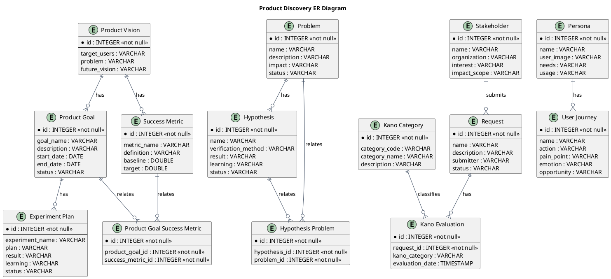
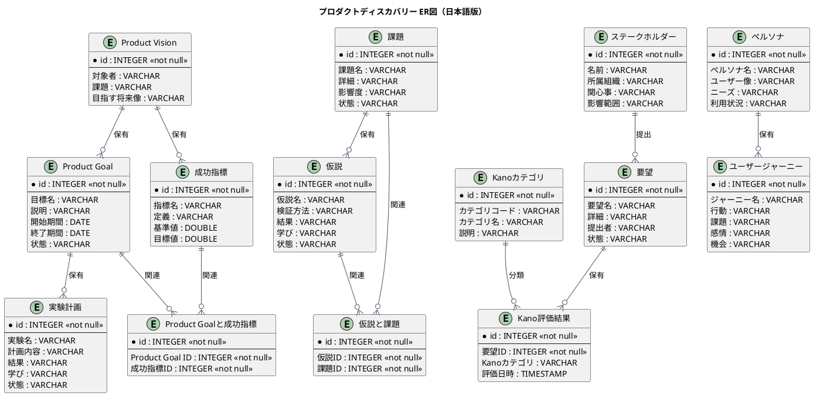

# ER図

プロダクトディスカバリー業務領域で扱う情報（エンティティ）間の関係を示すER図です。

## 1. 目的

本書は、AG-01 プロダクトディスカバリー
業務領域のシステムレイヤーで扱う情報（エンティティ）間の関係を示すER図（エンティティ関係図）です。

## 2. PlantUML ER図（英語版）

## 3. 日本語版 ER図

## 4. 情報（エンティティ）一覧

| 情報ID | 情報名 | 英語名 | 説明 | 情報種類 |
|--------|--------|--------|------|----------|
| INF-DIS-01 | Product Vision | ProductVision | プロダクトの対象者、課題、目指す将来像 | リソース |
| INF-DIS-02 | Product Goal | ProductGoal | プロダクト目標、期間、状態 | リソース |
| INF-DIS-03 | 課題 | Problem | 業務上の困りごとや繰り返し発生する問題 | リソース |
| INF-DIS-04 | 要望 | Request | 顧客や利用者から受けた意見 | リソース |
| INF-DIS-05 | 仮説 | Hypothesis | 課題に対する検証可能な仮説 | リソース |
| INF-DIS-06 | ステークホルダー | Stakeholder | 関係者、関心事、影響範囲 | リソース |
| INF-DIS-07 | ペルソナ | Persona | ユーザー像、ニーズ、利用状況 | リソース |
| INF-DIS-08 | ユーザージャーニー | UserJourney | 利用者の行動、課題、感情、機会 | リソース |
| INF-DIS-09 | 成功指標 | SuccessMetric | 指標の定義、基準値、目標値 | リソース |
| INF-DIS-10 | Kano評価結果 | KanoEvaluation | 要望のKano分類結果 | リソース |
| INF-DIS-11 | 実験計画 | ExperimentPlan | 実験計画、結果、学び | リソース |
| INF-DIS-12 | Product Goalと成功指標 | ProductGoalSuccessMetric | 目標と指標の関連 | 対応表 |
| INF-DIS-13 | 仮説と課題 | HypothesisProblem | 仮説と関連する課題の関連 | 対応表 |
| INF-DIS-14 | Kanoカテゴリ | KanoCategory | 当たり前品質、一元品質、魅力的品質、無関心品質、逆品質 | 対照表 |

## 5. 関係一覧

| 関係ID | 元情報ID | 元情報名 | 先情報ID | 先情報名 | 関係の種類 | 説明 |
|--------|----------|----------|----------|----------|------------|------|
| REL-DIS-01 | INF-DIS-01 | Product Vision | INF-DIS-02 | Product Goal | 1対多 | Product Visionは複数のProduct Goalを持つ |
| REL-DIS-02 | INF-DIS-01 | Product Vision | INF-DIS-09 | 成功指標 | 1対多 | Product Visionは複数の成功指標を持つ |
| REL-DIS-03 | INF-DIS-02 | Product Goal | INF-DIS-11 | 実験計画 | 1対多 | Product Goalは複数の実験計画を持つ |
| REL-DIS-04 | INF-DIS-03 | 課題 | INF-DIS-05 | 仮説 | 1対多 | 課題は複数の仮説を持つ |
| REL-DIS-05 | INF-DIS-06 | ステークホルダー | INF-DIS-04 | 要望 | 1対多 | ステークホルダーは複数の要望を提出する |
| REL-DIS-06 | INF-DIS-04 | 要望 | INF-DIS-10 | Kano評価結果 | 1対多 | 要望は複数のKano評価結果を持つ |
| REL-DIS-07 | INF-DIS-07 | ペルソナ | INF-DIS-08 | ユーザージャーニー | 1対多 | ペルソナは複数のユーザージャーニーを持つ |
| REL-DIS-08 | INF-DIS-14 | Kanoカテゴリ | INF-DIS-10 | Kano評価結果 | 1対多 | Kanoカテゴリは複数のKano評価結果に分類される |
| REL-DIS-09 | INF-DIS-02 | Product Goal | INF-DIS-12 | Product Goalと成功指標 | 1対多 | Product Goalは複数の成功指標と関連する |
| REL-DIS-10 | INF-DIS-09 | 成功指標 | INF-DIS-12 | Product Goalと成功指標 | 1対多 | 成功指標は複数のProduct Goalと関連する |
| REL-DIS-11 | INF-DIS-05 | 仮説 | INF-DIS-13 | 仮説と課題 | 1対多 | 仮説は複数の課題と関連する |
| REL-DIS-12 | INF-DIS-03 | 課題 | INF-DIS-13 | 仮説と課題 | 1対多 | 課題は複数の仮説と関連する |

## 6. 関係の種類

関係の種類は以下の記号で表現します：

| 記号 | 意味 | 説明 |
|------|------|------|
| `||--o{` | 1対多 (1:N) | 左側の1つが右側の0個以上に関連 |
| `||--||` | 1対1 (1:1) | 左側の1つが右側の1つに関連 |
| `}o--o{` | 多対多 (N:M) | 左側の0個以上が右側の0個以上に関連 |
| `||--o|` | 1対1以上 (1:1+) | 左側の1つが右側の1個以上に関連 |

## 7. 参照情報

- 情報一覧: `04.システム/01.情報/情報一覧.md`
- 情報属性一覧: `04.システム/03.情報属性/`
- UC複合図: `03.システム境界/UC複合図.md`
