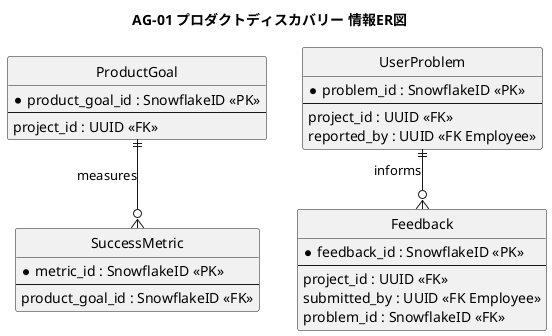
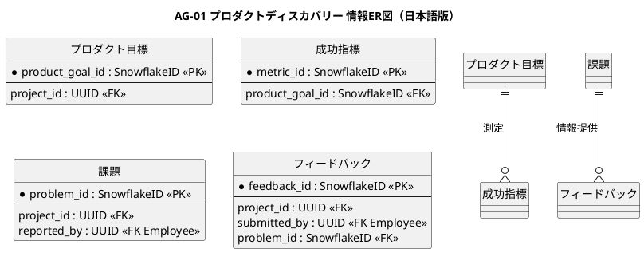

# 情報ER図

プロダクトディスカバリー業務領域で扱う情報の関係を示すER図です。

## 1. 目的

本書は、AG-01 プロダクトディスカバリー業務領域のシステムレイヤーで扱う情報エンティティ間の関係を示すER図です。

## 2. PlantUML ER図

## 3. 日本語版 ER図

## 4. エンティティ一覧

| エンティティ  | 情報名 (ID)               | 説明                                   |
|---------------|---------------------------|----------------------------------------|
| ProductGoal   | Product Goal (INF-DIS-02) | プロダクト目標、期間、状態             |
| SuccessMetric | 成功指標 (INF-DIS-09)     | 指標の定義、基準値、目標値             |
| UserProblem   | 課題 (INF-DIS-03)         | 業務上の困りごとや繰り返し発生する問題 |
| Feedback      | 要望 (INF-DIS-04)         | 顧客や利用者から受けた意見             |

## 5. 主要な関係

- **ProductGoal → SuccessMetric**：目標に対する成功指標の定義（Product Goalと成功指標: INF-DIS-12）
- **UserProblem → Feedback**：課題に対するフィードバック

## 6. 参照エンティティ

以下のエンティティは他の業務領域で定義され、参照として使用されます。

| エンティティ | 所属業務領域 | 説明         |
|--------------|--------------|--------------|
| Project      | 共通         | プロジェクト |
| Employee     | 共通         | 従業員       |
