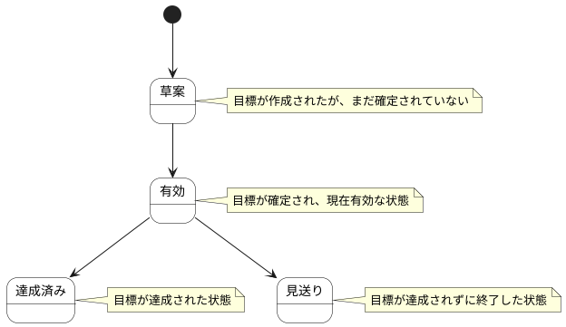

# Product Goal ステートチャート

Product Goal情報の状態遷移を示します。

## 状態一覧

| 状態ID | 状態名 | 説明 |
|--------|--------|------|
| ST-DIS-01 | 草案 | 目標が作成されたが、まだ確定されていない |
| ST-DIS-02 | 有効 | 目標が確定され、現在有効な状態 |
| ST-DIS-03 | 達成済み | 目標が達成された状態 |
| ST-DIS-04 | 見送り | 目標が達成されずに終了した状態 |
