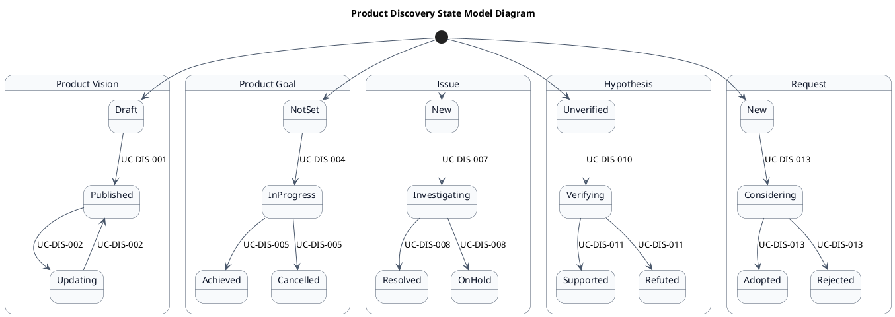
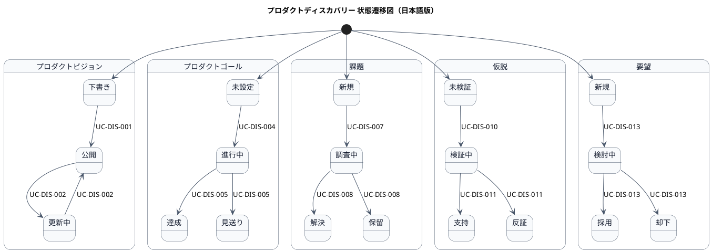

# AG-01 プロダクトディスカバリー ステートマシン図

## 1. 目的

本書は、AG-01 プロダクトディスカバリー業務領域のシステムレイヤーで扱う情報の状態遷移を示す状態モデル図（ステートマシン図）です。

## 2. PlantUML 状態遷移図（英語版）

## 3. 日本語版 状態遷移図

## 4. 状態一覧

| 状態名 (ID)       | 英語名    | 説明 |
|-------------------|-----------|------|
| プロダクトビジョン状態 | ProductVisionState | プロダクトビジョンの状態遷移 |
| プロダクトゴール状態 | ProductGoalState | プロダクトゴールの状態遷移 |
| 課題状態 | IssueState | 課題の状態遷移 |
| 仮説状態 | HypothesisState | 仮説の状態遷移 |
| 要望状態 | RequestState | 要望の状態遷移 |

## 5. 遷移一覧

| 遷移ID | 元状態       | 遷移先状態 | トリガー  | 関連ユースケース | 説明 |
|--------|--------------|------------|-----------|------------------|------|
| TR-DIS-01 | start | 下書き | - | - | プロダクトビジョンの初期状態 |
| TR-DIS-02 | 下書き | 公開 | ビジョン作成 | UC-DIS-001 | ビジョンを作成して公開する |
| TR-DIS-03 | 公開 | 更新中 | ビジョン更新開始 | UC-DIS-002 | ビジョンを更新し始める |
| TR-DIS-04 | 更新中 | 公開 | ビジョン更新完了 | UC-DIS-002 | ビジョンの更新を完了する |
| TR-DIS-05 | start | 未設定 | - | - | プロダクトゴールの初期状態 |
| TR-DIS-06 | 未設定 | 進行中 | ゴール作成 | UC-DIS-004 | ゴールを作成して進行中にする |
| TR-DIS-07 | 進行中 | 達成 | ゴール達成 | UC-DIS-005 | ゴールを達成する |
| TR-DIS-08 | 進行中 | 見送り | ゴール見送り | UC-DIS-005 | ゴールを見送る |
| TR-DIS-09 | start | 新規 | - | - | 課題の初期状態 |
| TR-DIS-10 | 新規 | 調査中 | 課題登録 | UC-DIS-007 | 課題を登録して調査を開始する |
| TR-DIS-11 | 調査中 | 解決 | 課題解決 | UC-DIS-008 | 課題を解決する |
| TR-DIS-12 | 調査中 | 保留 | 課題保留 | UC-DIS-008 | 課題を保留にする |
| TR-DIS-13 | start | 未検証 | - | - | 仮説の初期状態 |
| TR-DIS-14 | 未検証 | 検証中 | 仮説作成 | UC-DIS-010 | 仮説を作成して検証を開始する |
| TR-DIS-15 | 検証中 | 支持 | 仮説支持 | UC-DIS-011 | 仮説が支持される |
| TR-DIS-16 | 検証中 | 反証 | 仮説反証 | UC-DIS-011 | 仮説が反証される |
| TR-DIS-17 | start | 新規 | - | - | 要望の初期状態 |
| TR-DIS-18 | 新規 | 検討中 | 要望登録 | UC-DIS-013 | 要望を登録して検討を開始する |
| TR-DIS-19 | 検討中 | 採用 | 要望採用 | UC-DIS-013 | 要望を採用する |
| TR-DIS-20 | 検討中 | 却下 | 要望却下 | UC-DIS-013 | 要望を却下する |

## 6. 参照情報

- ステート一覧: `02.ステート/ステート一覧.tsv`
- 関連ユースケース: `03.システム境界/01.ユースケース/ユースケース一覧.md`
