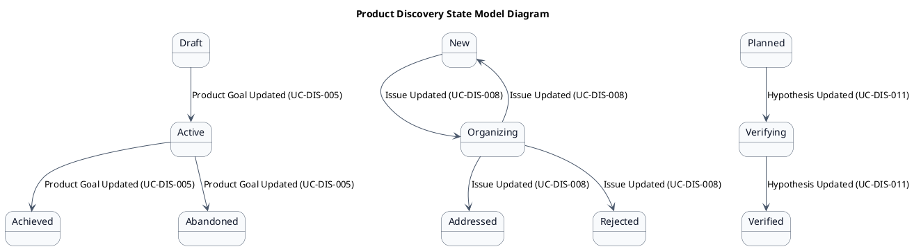
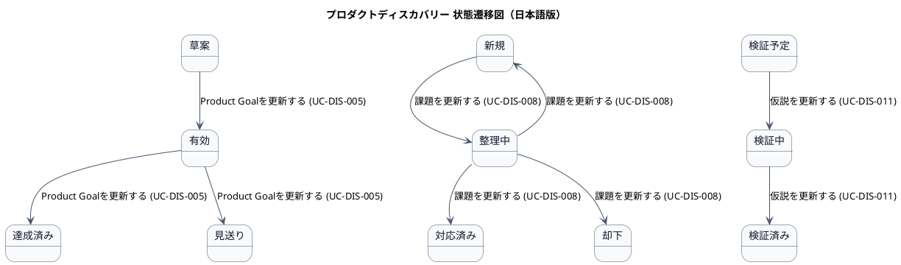

# ステートマシン図

プロダクトディスカバリー業務領域で扱う情報の状態遷移を示す状態モデル図です。

## 1. 目的

本書は、AG-01 プロダクトディスカバリー業務領域のシステムレイヤーで扱う情報の状態遷移を示す状態モデル図（ステートマシン図）です。

## 2. PlantUML 状態遷移図（英語版）

## 3. 日本語版 状態遷移図

## 4. 状態一覧

| 状態名 (ID)       | 英語名        | 対象情報     | 説明                                     |
|-------------------|---------------|--------------|------------------------------------------|
| 草案 (ST-DIS-01)  | Draft         | Product Goal | 目標が作成されたが、まだ確定されていない |
| 有効 (ST-DIS-02)  | Active        | Product Goal | 目標が確定され、現在有効な状態           |
| 達成済み (ST-DIS-03) | Achieved  | Product Goal | 目標が達成された状態                     |
| 見送り (ST-DIS-04) | Abandoned   | Product Goal | 目標が達成されずに終了した状態           |
| 新規 (ST-DIS-05)  | New           | 課題・要望   | 登録されたが、まだ整理されていない       |
| 整理中 (ST-DIS-06) | Organizing  | 課題・要望   | POが背景・影響を整理中                   |
| 対応済み (ST-DIS-07) | Addressed | 課題・要望   | バックログ項目に変換された               |
| 却下 (ST-DIS-08)  | Rejected      | 課題・要望   | 対応しないことが決定された               |
| 検証予定 (ST-DIS-09) | Planned   | 仮説         | 仮説が作成され、検証計画が立てられた     |
| 検証中 (ST-DIS-10) | Verifying   | 仮説         | 検証が進行中                             |
| 検証済み (ST-DIS-11) | Verified  | 仮説         | 検証が完了し、結果が記録された           |

## 5. 遷移一覧

| 遷移ID | 元状態       | 遷移先状態 | トリガー                          | 関連ユースケース              | 説明                                     |
|--------|--------------|------------|-----------------------------------|-------------------------------|------------------------------------------|
| TR-DIS-01 | 草案      | 有効       | Product Goalを更新する (UC-DIS-005) | UC-DIS-005                   | 目標が確定された                         |
| TR-DIS-02 | 有効      | 達成済み   | Product Goalを更新する (UC-DIS-005) | UC-DIS-005                   | 目標が達成された                         |
| TR-DIS-03 | 有効      | 見送り     | Product Goalを更新する (UC-DIS-005) | UC-DIS-005                   | 目標が達成されずに終了した               |
| TR-DIS-04 | 新規      | 整理中     | 課題を更新する (UC-DIS-008)         | UC-DIS-008                   | POが背景・影響を整理開始                 |
| TR-DIS-05 | 整理中    | 新規       | 課題を更新する (UC-DIS-008)         | UC-DIS-008                   | 整理をキャンセルして新規に戻した         |
| TR-DIS-06 | 整理中    | 対応済み   | 課題を更新する (UC-DIS-008)         | UC-DIS-008                   | バックログ項目に変換された               |
| TR-DIS-07 | 整理中    | 却下       | 課題を更新する (UC-DIS-008)         | UC-DIS-008                   | 対応しないことが決定された               |
| TR-DIS-08 | 検証予定  | 検証中     | 仮説を更新する (UC-DIS-011)         | UC-DIS-011                   | 検証が開始された                         |
| TR-DIS-09 | 検証中    | 検証済み   | 仮説を更新する (UC-DIS-011)         | UC-DIS-011                   | 検証が完了し、結果が記録された           |

## 6. 参照情報

- ステート一覧: `02.ステート/ステート一覧.tsv`
- 関連ユースケース: `03.システム境界/01.ユースケース/ユースケース一覧.md`
