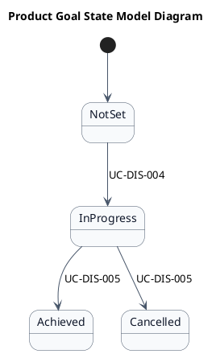
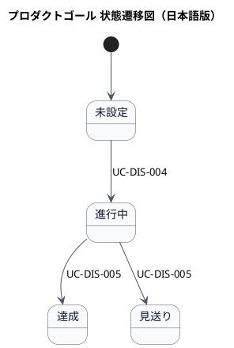

# ステートマシン図 - プロダクトゴール

プロダクトゴールの状態遷移をPlantUMLで視覚化します。

## 状態遷移図

## 日本語版 状態遷移図

## 状態一覧

| 状態名 | 英語名     | 説明                       | 遷移元 | 遷移先       | トリガーUC             |
|--------|------------|----------------------------|--------|--------------|------------------------|
| 未設定 | NotSet     | プロダクトゴールの初期状態 | -      | 進行中       | UC-DIS-004             |
| 進行中 | InProgress | ゴールが進行中の状態       | 未設定 | 達成, 見送り | UC-DIS-004, UC-DIS-005 |
| 達成   | Achieved   | ゴールが達成された状態     | 進行中 | -            | UC-DIS-005             |
| 見送り | Cancelled  | ゴールが見送られた状態     | 進行中 | -            | UC-DIS-005             |
