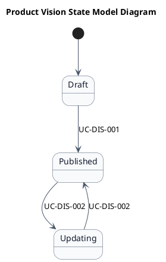
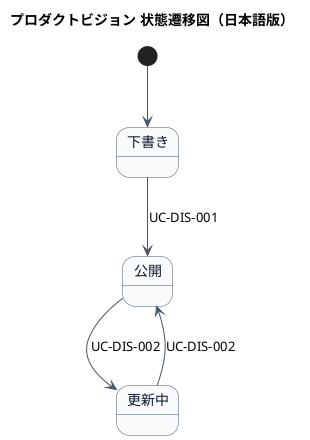

# ステートマシン図 - プロダクトビジョン

プロダクトビジョンの状態遷移をPlantUMLで視覚化します。

## 状態遷移図

## 日本語版 状態遷移図

## 状態一覧

| 状態名 | 英語名    | 説明                         | 遷移元         | 遷移先 | トリガーUC             |
|--------|-----------|------------------------------|----------------|--------|------------------------|
| 下書き | Draft     | プロダクトビジョンの初期状態 | -              | 公開   | UC-DIS-001             |
| 公開   | Published | ビジョンが公開された状態     | 下書き, 更新中 | 更新中 | UC-DIS-001, UC-DIS-002 |
| 更新中 | Updating  | ビジョンの更新が進行中の状態 | 公開           | 公開   | UC-DIS-002             |
