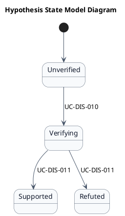
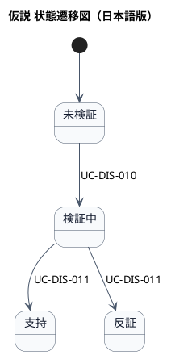

# ステートマシン図 - 仮説

仮説の状態遷移をPlantUMLで視覚化します。

## 状態遷移図

## 日本語版 状態遷移図

## 状態一覧

| 状態名 | 英語名     | 説明                     | 遷移元 | 遷移先     | トリガーUC             |
|--------|------------|--------------------------|--------|------------|------------------------|
| 未検証 | Unverified | 仮説の初期状態           | -      | 検証中     | UC-DIS-010             |
| 検証中 | Verifying  | 仮説の検証が進行中の状態 | 未検証 | 支持, 反証 | UC-DIS-010, UC-DIS-011 |
| 支持   | Supported  | 仮説が支持された状態     | 検証中 | -          | UC-DIS-011             |
| 反証   | Refuted    | 仮説が反証された状態     | 検証中 | -          | UC-DIS-011             |
