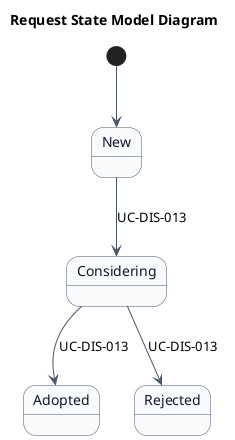
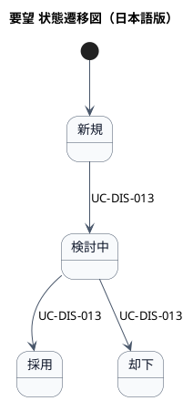

# ステートマシン図 - 要望

要望の状態遷移をPlantUMLで視覚化します。

## 状態遷移図

## 日本語版 状態遷移図

## 状態一覧

| 状態名 | 英語名      | 説明                     | 遷移元 | 遷移先     | トリガーUC |
|--------|-------------|--------------------------|--------|------------|------------|
| 新規   | New         | 要望の初期状態           | -      | 検討中     | UC-DIS-013 |
| 検討中 | Considering | 要望の検討が進行中の状態 | 新規   | 採用, 却下 | UC-DIS-013 |
| 採用   | Adopted     | 要望が採用された状態     | 検討中 | -          | UC-DIS-013 |
| 却下   | Rejected    | 要望が却下された状態     | 検討中 | -          | UC-DIS-013 |
