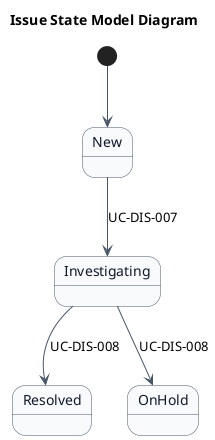
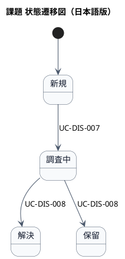

# ステートマシン図 - 課題

課題の状態遷移をPlantUMLで視覚化します。

## 状態遷移図

## 日本語版 状態遷移図

## 状態一覧

| 状態名 | 英語名        | 説明                     | 遷移元 | 遷移先     | トリガーUC             |
|--------|---------------|--------------------------|--------|------------|------------------------|
| 新規   | New           | 課題の初期状態           | -      | 調査中     | UC-DIS-007             |
| 調査中 | Investigating | 課題の調査が進行中の状態 | 新規   | 解決, 保留 | UC-DIS-007, UC-DIS-008 |
| 解決   | Resolved      | 課題が解決された状態     | 調査中 | -          | UC-DIS-008             |
| 保留   | OnHold        | 課題が保留された状態     | 調査中 | -          | UC-DIS-008             |
