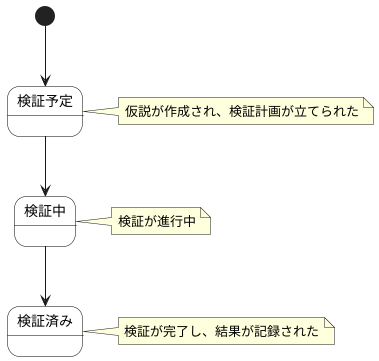

# 仮説 ステートチャート

仮説情報の状態遷移を示します。

## 状態一覧

| 状態ID | 状態名 | 説明 |
|--------|--------|------|
| ST-DIS-09 | 検証予定 | 仮説が作成され、検証計画が立てられた |
| ST-DIS-10 | 検証中 | 検証が進行中 |
| ST-DIS-11 | 検証済み | 検証が完了し、結果が記録された |
