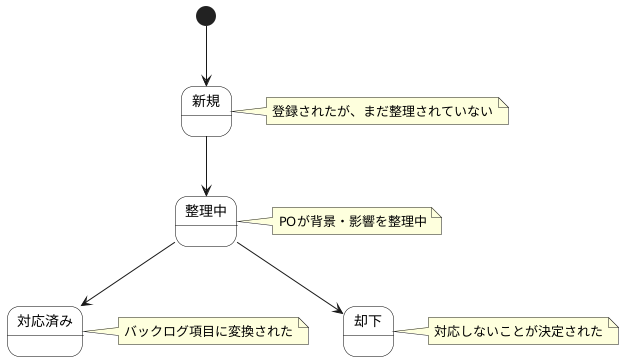

# 課題・要望 ステートチャート

課題・要望情報の状態遷移を示します。

## 状態一覧

| 状態ID | 状態名 | 説明 |
|--------|--------|------|
| ST-DIS-05 | 新規 | 登録されたが、まだ整理されていない |
| ST-DIS-06 | 整理中 | POが背景・影響を整理中 |
| ST-DIS-07 | 対応済み | バックログ項目に変換された |
| ST-DIS-08 | 却下 | 対応しないことが決定された |
