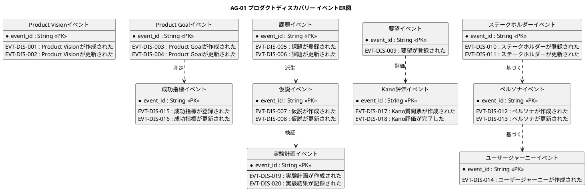

# イベントER図

プロダクトディスカバリー業務領域で発生するドメインイベントの関係を示すER図です。

## 1. 目的

本書は、AG-01 プロダクトディスカバリー業務領域のシステムレイヤーで発生するドメインイベント間の関係を示すER図です。

## 2. PlantUML ER図



## 3. 日本語版 ER図

```plantuml
@startuml
title AG-01 プロダクトディスカバリー イベントER図（日本語版）
hide circle
skinparam linetype ortho
skinparam shadowing false
skinparam entity {
  BackgroundColor #F8FAFC
  BorderColor #475569
  FontColor #0F172A
}
skinparam packageStyle rectangle

entity "Product Visionイベント" as ProductVisionEvents {
  * イベントID : String <<PK>>
  --
  EVT-DIS-001 : Product Visionが作成された
  EVT-DIS-002 : Product Visionが更新された
}

entity "Product Goalイベント" as ProductGoalEvents {
  * イベントID : String <<PK>>
  --
  EVT-DIS-003 : Product Goalが作成された
  EVT-DIS-004 : Product Goalが更新された
}

entity "課題イベント" as ProblemEvents {
  * イベントID : String <<PK>>
  --
  EVT-DIS-005 : 課題が登録された
  EVT-DIS-006 : 課題が更新された
}

entity "要望イベント" as FeedbackEvents {
  * イベントID : String <<PK>>
  --
  EVT-DIS-009 : 要望が登録された
}

entity "仮説イベント" as HypothesisEvents {
  * イベントID : String <<PK>>
  --
  EVT-DIS-007 : 仮説が作成された
  EVT-DIS-008 : 仮説が更新された
}

entity "ステークホルダーイベント" as StakeholderEvents {
  * イベントID : String <<PK>>
  --
  EVT-DIS-010 : ステークホルダーが登録された
  EVT-DIS-011 : ステークホルダーが更新された
}

entity "ペルソナイベント" as PersonaEvents {
  * イベントID : String <<PK>>
  --
  EVT-DIS-012 : ペルソナが作成された
  EVT-DIS-013 : ペルソナが更新された
}

entity "ユーザージャーニーイベント" as UserJourneyEvents {
  * イベントID : String <<PK>>
  --
  EVT-DIS-014 : ユーザージャーニーが作成された
}

entity "成功指標イベント" as SuccessMetricEvents {
  * イベントID : String <<PK>>
  --
  EVT-DIS-015 : 成功指標が登録された
  EVT-DIS-016 : 成功指標が更新された
}

entity "Kano評価イベント" as KanoEvaluationEvents {
  * イベントID : String <<PK>>
  --
  EVT-DIS-017 : Kano質問票が作成された
  EVT-DIS-018 : Kano評価が完了した
}

entity "実験計画イベント" as ExperimentEvents {
  * イベントID : String <<PK>>
  --
  EVT-DIS-019 : 実験計画が作成された
  EVT-DIS-020 : 実験結果が記録された
}

' 課題から仮説へ
課題イベント ..> 仮説イベント : 派生

' 仮説から実験計画へ
仮説イベント ..> 実験計画イベント : 検証

' ステークホルダーからペルソナへ
ステークホルダーイベント ..> ペルソナイベント : 基づく

' ペルソナからユーザージャーニーへ
ペルソナイベント ..> ユーザージャーニーイベント : 基づく

' 要望からKano評価へ
要望イベント ..> Kano評価イベント : 評価

' Product Goalから成功指標へ
Product Goalイベント ..> 成功指標イベント : 測定

@enduml
```

## 4. イベントエンティティ一覧

| イベントエンティティ     | イベントID  | イベント名                     | 関連情報   | 集約               |
|--------------------------|-------------|--------------------------------|------------|--------------------|
| ProductVisionEvents      | EVT-DIS-001 | Product Visionが作成された     | INF-DIS-01 | Product Vision     |
| ProductVisionEvents      | EVT-DIS-002 | Product Visionが更新された     | INF-DIS-01 | Product Vision     |
| ProductGoalEvents        | EVT-DIS-003 | Product Goalが作成された       | INF-DIS-02 | Product Goal       |
| ProductGoalEvents        | EVT-DIS-004 | Product Goalが更新された       | INF-DIS-02 | Product Goal       |
| ProblemEvents            | EVT-DIS-005 | 課題が登録された               | INF-DIS-03 | 課題               |
| ProblemEvents            | EVT-DIS-006 | 課題が更新された               | INF-DIS-03 | 課題               |
| FeedbackEvents           | EVT-DIS-009 | 要望が登録された               | INF-DIS-04 | 要望               |
| HypothesisEvents         | EVT-DIS-007 | 仮説が作成された               | INF-DIS-05 | 仮説               |
| HypothesisEvents         | EVT-DIS-008 | 仮説が更新された               | INF-DIS-05 | 仮説               |
| StakeholderEvents        | EVT-DIS-010 | ステークホルダーが登録された   | INF-DIS-06 | ステークホルダー   |
| StakeholderEvents        | EVT-DIS-011 | ステークホルダーが更新された   | INF-DIS-06 | ステークホルダー   |
| PersonaEvents            | EVT-DIS-012 | ペルソナが作成された           | INF-DIS-07 | ペルソナ           |
| PersonaEvents            | EVT-DIS-013 | ペルソナが更新された           | INF-DIS-07 | ペルソナ           |
| UserJourneyEvents        | EVT-DIS-014 | ユーザージャーニーが作成された | INF-DIS-08 | ユーザージャーニー |
| SuccessMetricEvents      | EVT-DIS-015 | 成功指標が登録された           | INF-DIS-09 | 成功指標           |
| SuccessMetricEvents      | EVT-DIS-016 | 成功指標が更新された           | INF-DIS-09 | 成功指標           |
| KanoEvaluationEvents     | EVT-DIS-017 | Kano質問票が作成された         | INF-DIS-10 | Kano評価結果       |
| KanoEvaluationEvents     | EVT-DIS-018 | Kano評価が完了した             | INF-DIS-10 | Kano評価結果       |
| ExperimentEvents         | EVT-DIS-019 | 実験計画が作成された           | INF-DIS-11 | 実験計画           |
| ExperimentEvents         | EVT-DIS-020 | 実験結果が記録された           | INF-DIS-11 | 実験計画           |

## 5. 主要な関係

- **課題イベント → 仮説イベント**：課題に対する仮説の派生
- **仮説イベント → 実験計画イベント**：仮説検証のための実験計画
- **ステークホルダーイベント → ペルソナイベント**：関係者に基づくペルソナ定義
- **ペルソナイベント → ユーザージャーニーイベント**：ペルソナに基づくジャーニー定義
- **要望イベント → Kano評価イベント**：要望のKano分類評価
- **Product Goalイベント → 成功指標イベント**：目標達成の測定
