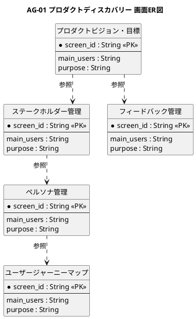

# 画面ER図

プロダクトディスカバリー業務領域が提供する画面の関係を示すER図です。

## 1. 目的

本書は、AG-01 プロダクトディスカバリー業務領域のシステムレイヤーで提供する画面エンティティ間の関係を示すER図です。

## 2. PlantUML ER図



## 3. 日本語版 ER図

```plantuml
@startuml
title AG-01 プロダクトディスカバリー 画面ER図（日本語版）
hide circle
skinparam linetype ortho
skinparam shadowing false
skinparam entity {
  BackgroundColor #F8FAFC
  BorderColor #475569
  FontColor #0F172A
}
skinparam packageStyle rectangle

entity "プロダクトビジョン・目標" as ProductVisionGoal {
  * 画面ID : String <<PK>>
  --
  主な利用者 : String
  画面の目的 : String
}

entity "ステークホルダー管理" as StakeholderMgmt {
  * 画面ID : String <<PK>>
  --
  主な利用者 : String
  画面の目的 : String
}

entity "フィードバック管理" as FeedbackMgmt {
  * 画面ID : String <<PK>>
  --
  主な利用者 : String
  画面の目的 : String
}

entity "ペルソナ管理" as PersonaMgmt {
  * 画面ID : String <<PK>>
  --
  主な利用者 : String
  画面の目的 : String
}

entity "ユーザージャーニーマップ" as UserJourneyMap {
  * 画面ID : String <<PK>>
  --
  主な利用者 : String
  画面の目的 : String
}

' プロダクトビジョン・目標からステークホルダー管理へ
プロダクトビジョン・目標 ..> ステークホルダー管理 : 参照

' プロダクトビジョン・目標からフィードバック管理へ
プロダクトビジョン・目標 ..> フィードバック管理 : 参照

' ステークホルダー管理からペルソナ管理へ
ステークホルダー管理 ..> ペルソナ管理 : 参照

' ペルソナ管理からユーザージャーニーマップへ
ペルソナ管理 ..> ユーザージャーニーマップ : 参照

@enduml
```

## 4. 画面エンティティ一覧

| 画面エンティティ     | 画面ID  | 画面名                   | 主な利用者           | 画面の目的                                               |
|----------------------|---------|--------------------------|----------------------|----------------------------------------------------------|
| ProductVisionGoal    | SCR-002 | プロダクトビジョン・目標 | PO、ステークホルダー | ビジョン、Product Goal、成功指標、仮説を管理する         |
| StakeholderMgmt      | SCR-003 | ステークホルダー管理     | PO、管理者           | 関係者、所属組織、関心、要望、参加状況を管理する         |
| FeedbackMgmt         | SCR-004 | フィードバック管理       | PO、ステークホルダー | 要望・意見・課題を記録し、評価・追跡する                 |
| PersonaMgmt          | SCR-005 | ペルソナ管理             | PO、UX担当           | ユーザー像、ニーズ、前提、根拠を整理する                 |
| UserJourneyMap       | SCR-006 | ユーザージャーニーマップ | PO、UX担当、チーム   | フェーズ、行動、タッチポイント、ペイン、機会を可視化する |

## 5. 主要な関係

- **プロダクトビジョン・目標 → ステークホルダー管理**：ビジョン達成のための関係者管理
- **プロダクトビジョン・目標 → フィードバック管理**：ビジョン検証のためのフィードバック収集
- **ステークホルダー管理 → ペルソナ管理**：関係者に基づくユーザー像の定義
- **ペルソナ管理 → ユーザージャーニーマップ**：ユーザー像に基づくジャーニーの可視化
