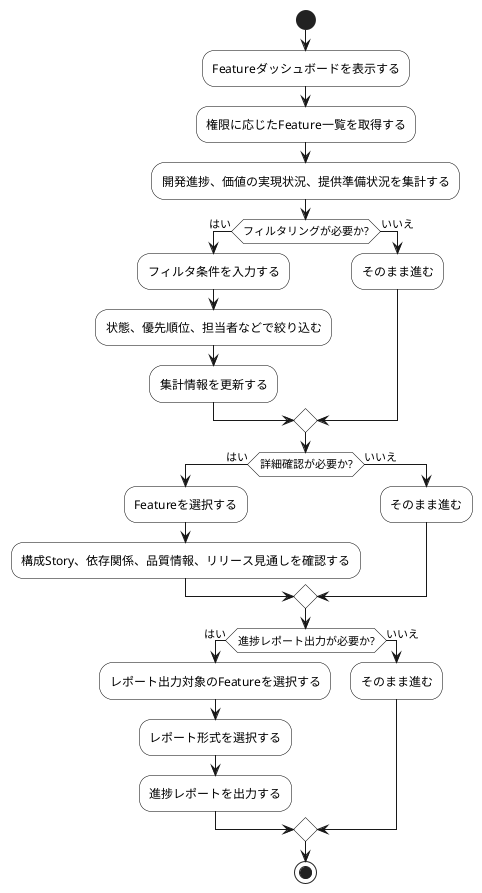

# BUC-BL-07 Featureダッシュボードによる価値実現状況把握

## 概要

Feature単位で価値の実現状況、開発進捗、品質、依存関係、リリース見通しを把握する。

## アクティビティ図

## アクティビティ一覧

| 番号   | アクティビティ名 | 説明                             | 担当アクター   |
|--------|------------------|----------------------------------|----------------|
| ACT-01 | ダッシュボード表示 | Featureダッシュボードを表示する | ACT-02, ACT-03, ACT-04, ACT-05 |
| ACT-02 | 権限確認         | ログインユーザーのロールを確認   | ACT-02, ACT-03, ACT-04, ACT-05 |
| ACT-03 | 集計             | 開発進捗、価値の実現状況、提供準備状況を集計する | ACT-02, ACT-03, ACT-04, ACT-05 |
| ACT-04 | フィルタリング   | 状態、優先順位、担当者などでFeatureを絞り込む | ACT-02, ACT-03, ACT-04, ACT-05 |
| ACT-05 | 集計情報更新     | 絞り込んだFeatureの集計情報を更新する | ACT-02, ACT-03, ACT-04, ACT-05 |
| ACT-06 | Feature選択     | ダッシュボードからFeatureを選択する | ACT-02, ACT-03, ACT-04, ACT-05 |
| ACT-07 | 詳細確認         | 構成Story、依存関係、品質情報、リリース見通しを確認する | ACT-02, ACT-03, ACT-04, ACT-05 |
| ACT-08 | レポート対象選択 | レポート出力対象のFeatureを選択する | ACT-02, ACT-05 |
| ACT-09 | レポート形式選択 | レポート形式（PDF、Excelなど）を選択する | ACT-02, ACT-05 |
| ACT-10 | レポート出力     | Featureの進捗状況をレポートとして出力する | ACT-02, ACT-05 |
