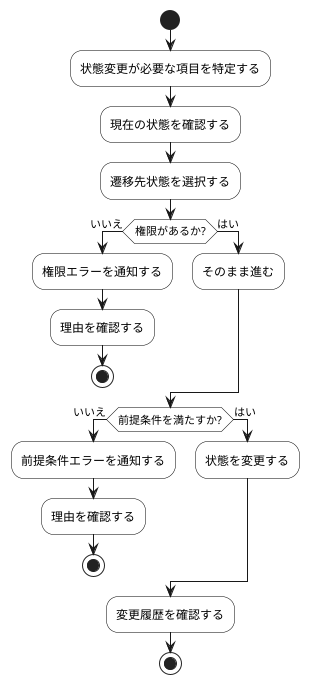

# BUC-BL-08 バックログ項目の状態管理

## 概要

バックログ項目の状態を7つの状態間で遷移させ、進捗を可視化する。

## アクティビティ図

## アクティビティ一覧

| 番号   | アクティビティ名 | 説明                             | 担当アクター   |
|--------|------------------|----------------------------------|----------------|
| ACT-01 | 項目特定         | 状態変更が必要な項目を特定する   | ACT-02, ACT-03, ACT-04 |
| ACT-02 | 状態確認         | 現在の状態を確認する             | ACT-02, ACT-03, ACT-04, ACT-05 |
| ACT-03 | 遷移先選択       | 遷移先状態を選択する             | ACT-02, ACT-03, ACT-04 |
| ACT-04 | 権限確認         | 遷移種別に応じた権限を確認する   | ACT-02, ACT-03, ACT-04 |
| ACT-05 | 前提条件確認     | 前提条件（Value、StoryPointなど）を確認する | ACT-02, ACT-03, ACT-04 |
| ACT-06 | エラー通知       | 権限エラーまたは前提条件エラーを通知する | ACT-02, ACT-03, ACT-04 |
| ACT-07 | 理由確認         | 条件不満たの理由を確認する       | ACT-02, ACT-03, ACT-04 |
| ACT-08 | 状態変更         | バックログ項目の状態を変更する   | ACT-02, ACT-03, ACT-04 |
| ACT-09 | 変更履歴確認     | 状態遷移を含む変更履歴を確認する | ACT-02, ACT-03, ACT-04, ACT-05 |
