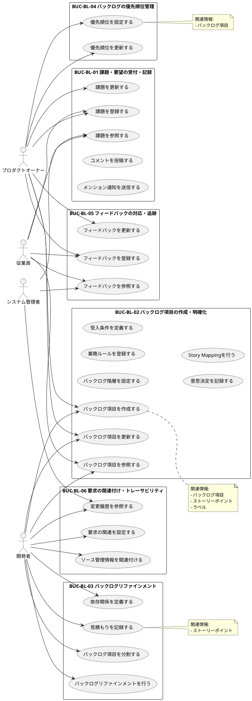

# UC複合図

バックログ管理のユースケースと関連要素をPlantUMLで視覚化します。

## ユースケース図

## 関連要素一覧

### 情報

| 情報ID | 情報名 | 関連UC |
|--------|--------|--------|
| INF-BL-01 | バックログ項目 | UC-BL-001〜UC-BL-025 |
| INF-BL-02 | ストーリーポイント | UC-BL-024 |
| INF-BL-03 | ラベル | UC-BL-008 |

### 条件

| 条件ID | 条件名 | 関連UC |
|--------|--------|--------|
| COND-BL-01 | バックログ項目の必須属性 | UC-BL-007 |
| COND-BL-02 | 優先順位の一意性 | UC-BL-012, UC-BL-013 |
| COND-BL-03 | ストーリーポイントの範囲 | UC-BL-024 |
| COND-BL-04 | ラベルの重複禁止 | UC-BL-008 |
| COND-BL-05 | 状態遷移の制約 | UC-BL-007, UC-BL-008, UC-BL-010, UC-BL-018 |

### 画面

| 画面ID | 画面名 | 関連UC |
|--------|--------|--------|
| SCR-BL-001 | バックログ一覧画面 | UC-BL-003, UC-BL-009, UC-BL-006, UC-BL-018 |
| SCR-BL-002 | バックログ詳細画面 | UC-BL-001, UC-BL-002, UC-BL-007, UC-BL-008, UC-BL-010, UC-BL-012, UC-BL-013, UC-BL-019, UC-BL-020, UC-BL-021, UC-BL-024, UC-BL-025 |
| SCR-BL-003 | バックログ編集画面 | UC-BL-007 |
