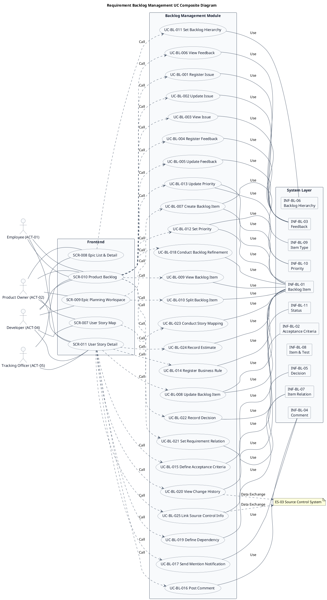
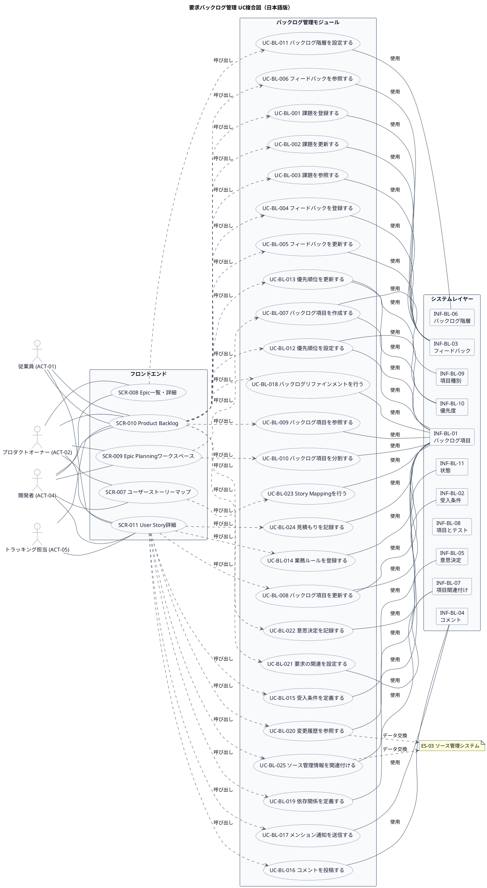

# UC複合図

要求バックログ管理業務領域で扱うユースケース、画面、イベント、情報などを関連づけたUC複合図です。

## 1. 目的

本書は、AG-02 要求バックログ管理業務領域のシステム境界レイヤーで扱うユースケース、画面、イベント、情報、条件を関連づけたUC複合図です。

## 2. PlantUML UC複合図（英語版）

## 3. 日本語版 UC複合図

## 4. ユースケース一覧

| ユースケースID | ユースケース名                   | 英語名                          | 説明                                                       | 関連アクター                       |
|----------------|----------------------------------|---------------------------------|------------------------------------------------------------|------------------------------------|
| UC-BL-001      | 課題を登録する                   | Register Issue                  | 従業員が課題、要望、利用場面、影響を登録する               | ACT-01, ACT-02                     |
| UC-BL-002      | 課題を更新する                   | Update Issue                    | 既存の課題の詳細・影響・状態を修正する                     | ACT-01, ACT-02                     |
| UC-BL-003      | 課題を参照する                   | View Issue                      | 登録された課題の一覧・詳細を確認する                       | ACT-01, ACT-02, ACT-05             |
| UC-BL-004      | フィードバックを登録する         | Register Feedback               | 利用者からの意見・評価を分類して記録する                   | ACT-01, ACT-02                     |
| UC-BL-005      | フィードバックを更新する         | Update Feedback                 | フィードバックの対応状況と判断理由を追跡する               | ACT-01, ACT-02                     |
| UC-BL-006      | フィードバックを参照する         | View Feedback                   | 登録されたフィードバックの一覧・詳細を確認する             | ACT-01, ACT-02, ACT-05             |
| UC-BL-007      | バックログ項目を作成する         | Create Backlog Item             | 課題や仮説をEpic・Feature・Storyに変換して登録する         | ACT-02, ACT-04                     |
| UC-BL-008      | バックログ項目を更新する         | Update Backlog Item             | 項目の説明・受入条件・詳細を修正する                       | ACT-02, ACT-04                     |
| UC-BL-009      | バックログ項目を参照する         | View Backlog Item               | 登録されたバックログ項目の一覧・詳細を確認する             | ACT-01, ACT-02, ACT-04, ACT-05     |
| UC-BL-010      | バックログ項目を分割する         | Split Backlog Item              | 大規模な項目を小さな実行可能な項目に分割する               | ACT-02, ACT-04                     |
| UC-BL-011      | バックログ階層を設定する         | Set Backlog Hierarchy           | Product Goal、Epic、Feature、Story、Task間の関係を設定する | ACT-02, ACT-04                     |
| UC-BL-012      | 優先順位を設定する               | Set Priority                    | 項目の順序・優先理由を設定する                             | ACT-02                             |
| UC-BL-013      | 優先順位を更新する               | Update Priority                 | 項目の順序・優先理由を修正する                             | ACT-02                             |
| UC-BL-014      | 業務ルールを登録する             | Register Business Rule          | 業務上の期待、例外、受入条件を項目に記録する               | ACT-02, ACT-04                     |
| UC-BL-015      | 受入条件を定義する               | Define Acceptance Criteria      | 期待される振る舞いや境界条件を定義する                     | ACT-02, ACT-04                     |
| UC-BL-016      | コメントを投稿する               | Post Comment                    | 項目上で質問、回答、議論を行う                             | ACT-01, ACT-02, ACT-04             |
| UC-BL-017      | メンション通知を送信する         | Send Mention Notification       | 関係者に通知を送信する                                     | ACT-01, ACT-02, ACT-04             |
| UC-BL-018      | バックログリファインメントを行う | Conduct Backlog Refinement      | 項目の説明・分割・受入条件・依存関係・準備状況を整える     | ACT-02, ACT-04                     |
| UC-BL-019      | 依存関係を定義する               | Define Dependency               | 項目間の依存関係を定義する                                 | ACT-02, ACT-04                     |
| UC-BL-020      | 変更履歴を参照する               | View Change History             | 要求、計画、テスト、リリースの関連と変更経緯を追跡する     | ACT-02, ACT-04, ACT-05             |
| UC-BL-021      | 要求の関連を設定する             | Set Requirement Relation        | 類似要求や関連する課題、機能、テストを関連づける           | ACT-02, ACT-04                     |
| UC-BL-022      | 意思決定を記録する               | Record Decision                 | 決定内容、根拠、決定者、影響範囲を記録する                 | ACT-02                             |
| UC-BL-023      | Story Mappingを行う              | Conduct Story Mapping           | ユーザー活動とストーリーを並べ、リリース範囲を検討する     | ACT-02, ACT-04                     |
| UC-BL-024      | 見積もりを記録する               | Record Estimate                 | チームの見積もり、リスク、未知事項を記録する               | ACT-02, ACT-04                     |
| UC-BL-025      | ソース管理情報を関連付ける       | Link Source Control Info        | コミット・ブランチ・PRをバックログ項目と関連付ける         | ACT-04                             |

## 5. 画面一覧

| 画面ID  | 画面名                      | 英語名                     | 主な利用者                       | 関連ユースケース |
|---------|-----------------------------|----------------------------|----------------------------------|------------------|
| SCR-007 | ユーザーストーリーマップ    | User Story Map             | PO、開発チーム、ステークホルダー | UC-BL-023        |
| SCR-008 | Epic一覧・詳細              | Epic List & Detail         | PO、チーム                       | UC-BL-011        |
| SCR-009 | Epic Planningワークスペース | Epic Planning Workspace    | PO、開発チーム                   | UC-BL-007, 010   |
| SCR-010 | Product Backlog             | Product Backlog            | PO、開発チーム                   | UC-BL-001〜006, 009, 012〜013, 018, 021〜022 |
| SCR-011 | User Story詳細              | User Story Detail          | PO、開発チーム、テスト担当       | UC-BL-008, 014〜017, 019〜020, 024〜025 |

## 6. イベント一覧

| イベントID | イベント名                           | 英語名                              | 説明                                                         | 関連ユースケース |
|------------|--------------------------------------|-------------------------------------|--------------------------------------------------------------|------------------|
| EVT-BL-001 | 課題が登録された                     | Issue Registered                    | 新規課題がシステムに記録された                               | UC-BL-001        |
| EVT-BL-002 | 課題が更新された                     | Issue Updated                       | 既存課題の詳細・影響・状態が修正された                       | UC-BL-002        |
| EVT-BL-003 | フィードバックが登録された           | Feedback Registered                 | 利用者からの意見・評価が記録された                           | UC-BL-004        |
| EVT-BL-004 | フィードバックが更新された           | Feedback Updated                    | フィードバックの対応状況と判断理由が追跡された               | UC-BL-005        |
| EVT-BL-005 | バックログ項目が作成された           | Backlog Item Created                | Epic・Feature・Storyなどのバックログ項目が登録された         | UC-BL-007        |
| EVT-BL-006 | バックログ項目が更新された           | Backlog Item Updated                | 項目の説明・受入条件・詳細が修正された                       | UC-BL-008        |
| EVT-BL-007 | バックログ項目が分割された           | Backlog Item Split                  | 大規模な項目が小さな実行可能な項目に分割された               | UC-BL-010        |
| EVT-BL-008 | バックログ階層が設定された           | Backlog Hierarchy Set               | Product Goal、Epic、Feature、Story間の関係が設定された       | UC-BL-011        |
| EVT-BL-009 | 優先順位が設定された                 | Priority Set                        | 項目の順序・優先理由が設定された                             | UC-BL-012        |
| EVT-BL-010 | 優先順位が更新された                 | Priority Updated                    | 項目の順序・優先理由が修正された                             | UC-BL-013        |
| EVT-BL-011 | 受入条件が定義された                 | Acceptance Criteria Defined         | 期待される振る舞いや境界条件が定義された                     | UC-BL-015        |
| EVT-BL-012 | コメントが投稿された                 | Comment Posted                      | 項目上で質問、回答、議論が行われた                           | UC-BL-016        |
| EVT-BL-013 | メンション通知が送信された           | Mention Notification Sent           | 関係者に通知が送信された                                     | UC-BL-017        |
| EVT-BL-014 | 依存関係が定義された                 | Dependency Defined                  | 項目間の依存関係が定義された                                 | UC-BL-019        |
| EVT-BL-015 | 要求の関連が設定された               | Requirement Relation Set            | 類似要求や関連する課題、機能、テストが関連づけられた         | UC-BL-021        |
| EVT-BL-016 | 意思決定が記録された                 | Decision Recorded                   | 決定内容、根拠、決定者、影響範囲が記録された                 | UC-BL-022        |
| EVT-BL-017 | 業務ルールが登録された               | Business Rule Registered            | 業務上の期待、例外、受入条件が項目に記録された               | UC-BL-014        |
| EVT-BL-018 | 見積もりが記録された                 | Estimate Recorded                   | チームの見積もり、リスク、未知事項が記録された               | UC-BL-024        |
| EVT-BL-019 | ソース管理情報が関連付けられた       | Source Control Info Linked          | コミット・ブランチ・PRがバックログ項目と関連付けられた       | UC-BL-025        |
| EVT-BL-020 | バックログリファインメントが完了した | Backlog Refinement Completed        | 項目の説明・分割・受入条件・依存関係・準備状況が整えられた   | UC-BL-018        |
| EVT-BL-021 | Story Mappingが完了した              | Story Mapping Completed             | ユーザー活動とストーリーが並べられ、リリース範囲が検討された | UC-BL-023        |

## 7. 情報一覧

| 情報ID    | 情報名         | 英語名             | 情報種類 | 説明                                           | 関連ユースケース |
|-----------|----------------|--------------------|----------|------------------------------------------------|------------------|
| INF-BL-01 | バックログ項目 | Backlog Item       | リソース | Epic、Feature、Story、欠陥などの項目           | UC-BL-007〜011, 012〜014, 018, 020, 023〜025 |
| INF-BL-02 | 受入条件       | Acceptance Criteria | リソース | 期待される振る舞いや境界条件                   | UC-BL-015        |
| INF-BL-03 | フィードバック | Feedback           | リソース | 利用者からの意見・評価                         | UC-BL-001〜006   |
| INF-BL-04 | コメント       | Comment            | リソース | 項目上の質問・回答・議論                       | UC-BL-016〜017   |
| INF-BL-05 | 意思決定       | Decision           | リソース | 決定内容、根拠、決定者                         | UC-BL-022        |
| INF-BL-06 | バックログ階層 | Backlog Hierarchy  | 対応表   | Product Goal、Epic、Feature、Story間の階層関係 | UC-BL-011        |
| INF-BL-07 | 項目関連付け   | Item Relation      | 対応表   | 要求間の重複・関連関係                         | UC-BL-019, 021   |
| INF-BL-08 | 項目とテスト   | Item & Test        | 対応表   | バックログ項目とテストケースの関連             | UC-BL-020        |
| INF-BL-09 | 項目種別       | Item Type          | 対照表   | Epic、Feature、Story、Task、欠陥               | UC-BL-007        |
| INF-BL-10 | 優先度         | Priority           | 対照表   | 項目の優先度区分                               | UC-BL-012〜013   |
| INF-BL-11 | 状態           | Status             | 対照表   | 項目のワークフロー状態                         | UC-BL-008        |

## 8. 参照情報

- ユースケース一覧: `01.ユースケース/ユースケース一覧.md`
- 画面一覧: `04.システム/04.画面/画面一覧.md`
- イベント一覧: `04.システム/03.イベント/イベント一覧.md`
- 情報一覧: `04.システム/01.情報/情報一覧.md`
- 外部システム一覧: `02.外部環境/01.外部システム定義/外部システム一覧.md`
