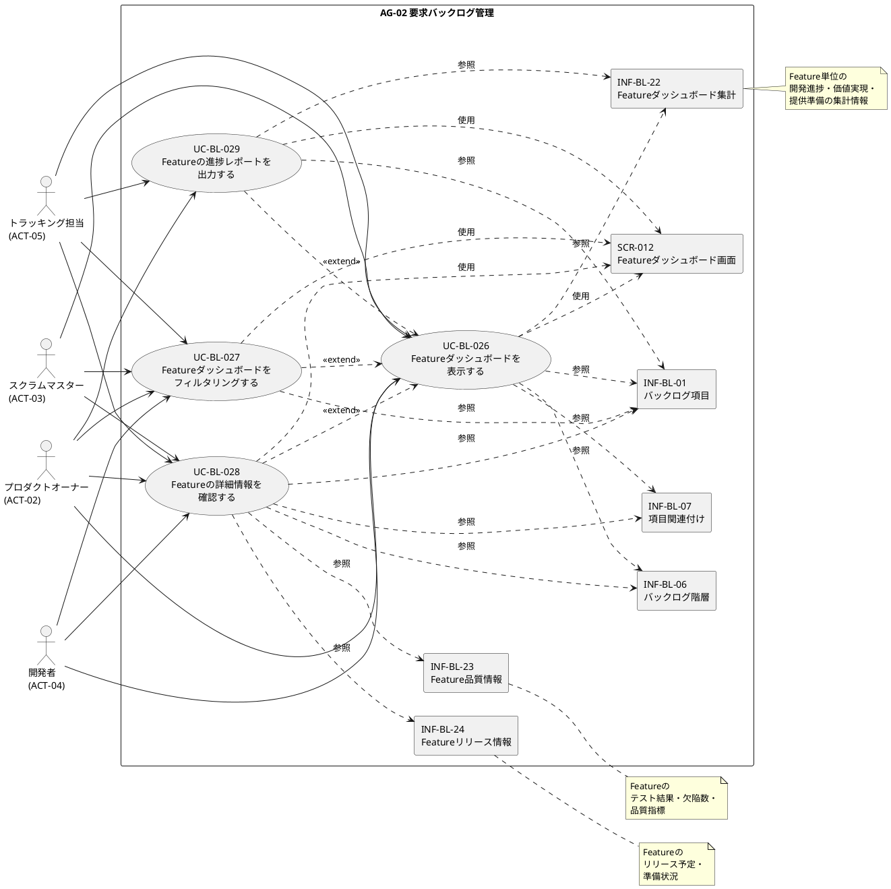

# UC複合図

Featureダッシュボードのユースケース、アクター、画面、イベント、情報、条件の関係性をPlantUMLで表現します。

## PlantUML

## 説明

このUC複合図は、Featureダッシュボードのユースケース、アクター、画面、情報の関係性を表現しています。

- **アクター**: PO、SM、開発者、トラッキング担当がFeatureダッシュボードを利用する
- **ユースケース**: UC-BL-026が基本ユースケースで、UC-BL-027〜029が拡張ユースケース
- **画面**: SCR-012（Featureダッシュボード画面）がすべてのユースケースで使用される
- **情報**: バックログ項目、バックログ階層、項目関連付け、Featureダッシュボード集計、Feature品質情報、Featureリリース情報を参照する
