# 情報ER図

要求・プロダクトバックログ管理業務領域で扱う情報の関係を示すER図です。

## 1. 目的

本書は、AG-02 要求バックログ管理業務領域のシステムレイヤーで扱う情報エンティティ間の関係を示すER図です。

## 2. PlantUML ER図

```plantuml
@startuml
title AG-02 要求バックログ管理 情報ER図
hide circle
skinparam linetype ortho
skinparam shadowing false
skinparam entity {
  BackgroundColor #F8FAFC
  BorderColor #475569
  FontColor #0F172A
}
skinparam packageStyle rectangle

entity "BacklogItem" as BacklogItem {
  * backlog_item_id : SnowflakeID <<PK>>
  --
  project_id : UUID <<FK>>
  product_goal_id : SnowflakeID <<FK>>
  parent_item_id : SnowflakeID <<FK>>
}

entity "AcceptanceCriterion" as AcceptanceCriterion {
  * acceptance_criterion_id : SnowflakeID <<PK>>
  --
  backlog_item_id : SnowflakeID <<FK>>
}

entity "Feedback" as Feedback {
  * feedback_id : SnowflakeID <<PK>>
  --
  project_id : UUID <<FK>>
  submitted_by : UUID <<FK Employee>>
  problem_id : SnowflakeID <<FK>>
}

entity "Comment" as Comment {
  * comment_id : SnowflakeID <<PK>>
  --
  backlog_item_id : SnowflakeID <<FK>>
  parent_comment_id : SnowflakeID <<FK>>
  posted_by : UUID <<FK Employee>>
}

entity "DecisionRecord" as DecisionRecord {
  * decision_id : SnowflakeID <<PK>>
  --
  project_id : UUID <<FK>>
  backlog_item_id : SnowflakeID <<FK>>
  decided_by : UUID <<FK Employee>>
}

entity "UserProblem" as UserProblem {
  * problem_id : SnowflakeID <<PK>>
  --
  project_id : UUID <<FK>>
  reported_by : UUID <<FK Employee>>
}

' === Story Mapping Entities ===

entity "StoryMap" as StoryMap {
  * id : Long <<PK>>
  --
  mapName : String
  description : String
  productId : Long <<FK>>
  creatorId : Long <<FK>>
  status : Enum
  version : String
}

entity "StoryMapActivity" as StoryMapActivity {
  * id : Long <<PK>>
  --
  storyMapId : Long <<FK>>
  name : String
  description : String
  personaId : Long <<FK>>
  displayOrder : Integer
}

entity "StoryMapTask" as StoryMapTask {
  * id : Long <<PK>>
  --
  activityId : Long <<FK>>
  name : String
  description : String
  expectedOutcome : String
  painPoint : String
  opportunity : String
  displayOrder : Integer
}

entity "StoryMapStory" as StoryMapStory {
  * id : Long <<PK>>
  --
  taskId : Long <<FK>>
  backlogItemId : Long <<FK BacklogItem>>
  displayOrder : Integer
}

entity "StoryMapReleaseSlice" as StoryMapReleaseSlice {
  * id : Long <<PK>>
  --
  storyMapId : Long <<FK>>
  name : String
  description : String
  displayOrder : Integer
}

entity "ReleaseSliceStory" as ReleaseSliceStory {
  * id : Long <<PK>>
  --
  releaseSliceId : Long <<FK>>
  backlogItemId : Long <<FK BacklogItem>>
}

entity "StoryMapPersona" as StoryMapPersona {
  * id : Long <<PK>>
  --
  storyMapId : Long <<FK>>
  personaId : Long <<FK>>
}

entity "StoryMapComment" as StoryMapComment {
  * id : Long <<PK>>
  --
  storyMapId : Long <<FK>>
  content : String
  authorId : Long <<FK>>
}

entity "StoryMapChangeHistory" as StoryMapChangeHistory {
  * id : Long <<PK>>
  --
  storyMapId : Long <<FK>>
  changeType : Enum
  targetEntity : String
  targetId : Long
  changeContent : String
  changedById : Long <<FK>>
}

' BacklogItem self-referencing hierarchy
BacklogItem ||--o{ BacklogItem : decomposes

' BacklogItem has AcceptanceCriteria
BacklogItem ||--o{ AcceptanceCriterion : has

' Feedback relates to UserProblem
UserProblem ||--o{ Feedback : informs

' Feedback relates to BacklogItem (via project)
BacklogItem ||--o{ Feedback : receives

' BacklogItem has Comments
BacklogItem ||--o{ Comment : has

' Comment self-referencing thread
Comment ||--o{ Comment : replies

' DecisionRecord concerns BacklogItem
BacklogItem ||--o{ DecisionRecord : concerns

' === Story Mapping Relationships ===

' StoryMap owns Activities
StoryMap ||--o{ StoryMapActivity : has

' StoryMap owns Release Slices
StoryMap ||--o{ StoryMapReleaseSlice : has

' StoryMap has Personas (many-to-many)
StoryMap ||--o{ StoryMapPersona : has

' StoryMap has Comments
StoryMap ||--o{ StoryMapComment : has

' StoryMap has Change History
StoryMap ||--o{ StoryMapChangeHistory : tracks

' Activity owns Tasks
StoryMapActivity ||--o{ StoryMapTask : has

' Task has Story placements (references BacklogItem)
StoryMapTask ||--o{ StoryMapStory : has

' Story placement references BacklogItem (User Story)
BacklogItem ||--o{ StoryMapStory : referenced-by

' Release Slice has Story assignments (references BacklogItem)
StoryMapReleaseSlice ||--o{ ReleaseSliceStory : has

' Release Slice Story references BacklogItem (User Story)
BacklogItem ||--o{ ReleaseSliceStory : referenced-by

@enduml
```



## 3. 日本語版 ER図

```plantuml
@startuml
title AG-02 要求バックログ管理 情報ER図（日本語版）
hide circle
skinparam linetype ortho
skinparam shadowing false
skinparam entity {
  BackgroundColor #F8FAFC
  BorderColor #475569
  FontColor #0F172A
}
skinparam packageStyle rectangle

entity "バックログ項目" as BacklogItem {
  * backlog_item_id : SnowflakeID <<PK>>
  --
  project_id : UUID <<FK>>
  product_goal_id : SnowflakeID <<FK>>
  parent_item_id : SnowflakeID <<FK>>
}

entity "受入条件" as AcceptanceCriterion {
  * acceptance_criterion_id : SnowflakeID <<PK>>
  --
  backlog_item_id : SnowflakeID <<FK>>
}

entity "フィードバック" as Feedback {
  * feedback_id : SnowflakeID <<PK>>
  --
  project_id : UUID <<FK>>
  submitted_by : UUID <<FK Employee>>
  problem_id : SnowflakeID <<FK>>
}

entity "コメント" as Comment {
  * comment_id : SnowflakeID <<PK>>
  --
  backlog_item_id : SnowflakeID <<FK>>
  parent_comment_id : SnowflakeID <<FK>>
  posted_by : UUID <<FK Employee>>
}

entity "意思決定" as DecisionRecord {
  * decision_id : SnowflakeID <<PK>>
  --
  project_id : UUID <<FK>>
  backlog_item_id : SnowflakeID <<FK>>
  decided_by : UUID <<FK Employee>>
}

entity "課題" as UserProblem {
  * problem_id : SnowflakeID <<PK>>
  --
  project_id : UUID <<FK>>
  reported_by : UUID <<FK Employee>>
}

' === Story Mapping エンティティ ===

entity "Story Map" as StoryMap {
  * id : Long <<PK>>
  --
  mapName : String
  description : String
  productId : Long <<FK>>
  creatorId : Long <<FK>>
  status : Enum
  version : String
}

entity "Story Map Activity" as StoryMapActivity {
  * id : Long <<PK>>
  --
  storyMapId : Long <<FK>>
  name : String
  description : String
  personaId : Long <<FK>>
  displayOrder : Integer
}

entity "Story Map Task" as StoryMapTask {
  * id : Long <<PK>>
  --
  activityId : Long <<FK>>
  name : String
  description : String
  expectedOutcome : String
  painPoint : String
  opportunity : String
  displayOrder : Integer
}

entity "Story Map Story" as StoryMapStory {
  * id : Long <<PK>>
  --
  taskId : Long <<FK>>
  backlogItemId : Long <<FK バックログ項目>>
  displayOrder : Integer
}

entity "Story Map Release Slice" as StoryMapReleaseSlice {
  * id : Long <<PK>>
  --
  storyMapId : Long <<FK>>
  name : String
  description : String
  displayOrder : Integer
}

entity "Release Slice Story" as ReleaseSliceStory {
  * id : Long <<PK>>
  --
  releaseSliceId : Long <<FK>>
  backlogItemId : Long <<FK バックログ項目>>
}

entity "Story Map Persona" as StoryMapPersona {
  * id : Long <<PK>>
  --
  storyMapId : Long <<FK>>
  personaId : Long <<FK>>
}

entity "Story Map Comment" as StoryMapComment {
  * id : Long <<PK>>
  --
  storyMapId : Long <<FK>>
  content : String
  authorId : Long <<FK>>
}

entity "Story Map 変更履歴" as StoryMapChangeHistory {
  * id : Long <<PK>>
  --
  storyMapId : Long <<FK>>
  changeType : Enum
  targetEntity : String
  targetId : Long
  changeContent : String
  changedById : Long <<FK>>
}

' バックログ項目の自己参照階層
バックログ項目 ||--o{ バックログ項目 : 分解

' バックログ項目から受入条件へ
バックログ項目 ||--o{ 受入条件 : 持つ

' 課題からフィードバックへ
課題 ||--o{ フィードバック : 情報提供

' バックログ項目からフィードバックへ
バックログ項目 ||--o{ フィードバック : 受信

' バックログ項目からコメントへ
バックログ項目 ||--o{ コメント : 持つ

' コメントのスレッド
コメント ||--o{ コメント : 返信

' バックログ項目から意思決定へ
バックログ項目 ||--o{ 意思決定 : 関連

' === Story Mapping 関係 ===

' Story MapからActivityへ
Story Map ||--o{ Story Map Activity : 持つ

' Story MapからRelease Sliceへ
Story Map ||--o{ Story Map Release Slice : 持つ

' Story MapからPersonaへ
Story Map ||--o{ Story Map Persona : 関連

' Story MapからCommentへ
Story Map ||--o{ Story Map Comment : 持つ

' Story Mapから変更履歴へ
Story Map ||--o{ Story Map 変更履歴 : 記録

' ActivityからTaskへ
Story Map Activity ||--o{ Story Map Task : 持つ

' TaskからStory配置へ
Story Map Task ||--o{ Story Map Story : 持つ

' Story配置はバックログ項目を参照
バックログ項目 ||--o{ Story Map Story : 参照

' Release SliceからStory関連へ
Story Map Release Slice ||--o{ Release Slice Story : 持つ

' Release Slice Storyはバックログ項目を参照
バックログ項目 ||--o{ Release Slice Story : 参照

@enduml
```

## 4. エンティティ一覧

| エンティティ             | 情報名 (ID)                    | 説明                                           |
|----------------------------|--------------------------------|------------------------------------------------|
| BacklogItem                | バックログ項目 (INF-BL-01)     | Epic、Feature、Story、欠陥などの項目           |
| AcceptanceCriterion        | 受入条件 (INF-BL-02)           | 期待される振る舞いや境界条件                   |
| Feedback                   | フィードバック (INF-BL-03)     | 利用者からの意見・評価                         |
| Comment                    | コメント (INF-BL-04)           | 項目上の質問・回答・議論                       |
| DecisionRecord             | 意思決定 (INF-BL-05)           | 決定内容、根拠、決定者                         |
| UserProblem                | 課題 (INF-BL-12)               | 業務上の困りごとや繰り返し発生する問題         |
| StoryMap                   | Story Map (INF-BL-13)          | ユーザーストーリーマップの基本情報・状態       |
| StoryMapActivity           | Story Map Activity (INF-BL-14) | Story Map上のユーザーの大きな活動              |
| StoryMapTask               | Story Map Task (INF-BL-15)     | Activityを構成する具体的なユーザー行動         |
| StoryMapStory              | Story Map Story (INF-BL-16)    | Story Map上のStory配置・順序（対応表）         |
| StoryMapReleaseSlice       | Story Map Release Slice (INF-BL-17) | Story Map上のリリース単位のスライス    |
| ReleaseSliceStory          | Release Slice Story (INF-BL-18)| Release SliceとUser Storyの関連（対応表）      |
| StoryMapPersona            | Story Map Persona (INF-BL-19)  | Story MapとPersonaの関連（対応表）             |
| StoryMapComment            | Story Map Comment (INF-BL-20)  | Story Map上のコメント・議論                   |
| StoryMapChangeHistory      | Story Map 変更履歴 (INF-BL-21) | Story Mapの変更追跡（イベント）               |

## 5. 主要な関係

- **BacklogItem → BacklogItem**：Epic、Feature、Storyの階層関係（バックログ階層: INF-BL-06）
- **BacklogItem → AcceptanceCriterion**：項目の受入条件
- **BacklogItem → Feedback**：項目に対する利用者からのフィードバック
- **BacklogItem → Comment**：項目に対するコメント
- **BacklogItem → DecisionRecord**：項目に関する意思決定の記録
- **Comment → Comment**：コメントのスレッド（自己参照）
- **UserProblem → Feedback**：課題に対するフィードバック
- **StoryMap → StoryMapActivity**：マップに属するActivity一覧
- **StoryMap → StoryMapReleaseSlice**：マップに属するRelease Slice一覧
- **StoryMap → StoryMapPersona**：マップに関連するPersona一覧
- **StoryMap → StoryMapComment**：マップへのコメント一覧
- **StoryMap → StoryMapChangeHistory**：マップの変更履歴
- **StoryMapActivity → StoryMapTask**：Activityに属するTask一覧
- **StoryMapTask → StoryMapStory**：Taskに配置されたStory一覧（対応表）
- **StoryMapStory → BacklogItem**：配置されたStoryは既存のバックログ項目を参照
- **StoryMapReleaseSlice → ReleaseSliceStory**：スライスに含まれるStory一覧（対応表）
- **ReleaseSliceStory → BacklogItem**：スライスに割り当てられたStoryは既存のバックログ項目を参照

## 6. 参照エンティティ

以下のエンティティは他の業務領域で定義され、参照として使用されます。

| エンティティ | 所属業務領域 | 説明           |
|--------------|--------------|----------------|
| Project      | 共通         | プロジェクト   |
| ProductGoal  | AG-01        | プロダクト目標 |
| Employee     | 共通         | 従業員         |
