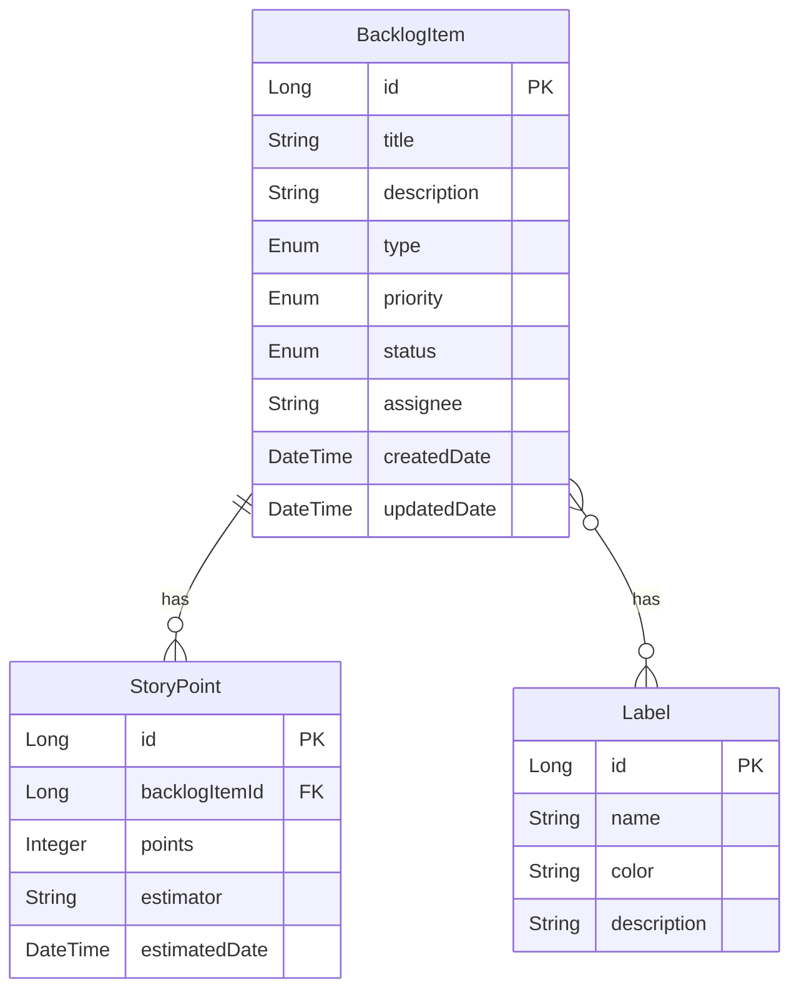

# 論理データモデル

バックログ管理の論理データモデルを定義します。

## ER図

## 論理データ一覧

| エンティティ | 説明 | 主キー | 外部キー | 関連エンティティ |
|-------------|------|--------|----------|-----------------|
| BacklogItem | バックログの詳細情報 | id | - | StoryPoint (1対多), Label (1対多) |
| StoryPoint | 見積もりポイント | id | backlogItemId | BacklogItem (多対1) |
| Label | バックログの分類ラベル | id | - | BacklogItem (多対多) |

## エンティティ詳細

### BacklogItem

| 属性名 | 型 | 必須 | 説明 |
|--------|----|------|------|
| id | Long | 必須 | バックログ項目の一意な識別子 |
| title | String | 必須 | 項目のタイトル |
| description | String | 必須 | 項目の詳細説明 |
| type | Enum | 必須 | 項目のタイプ（Epic, Feature, Story, Task） |
| priority | Enum | 必須 | 優先度（高, 中, 低） |
| status | Enum | 必須 | 状態（新規, 明確化中, 準備完了, 実装中, 完了） |
| assignee | String | 任意 | 担当者 |
| createdDate | DateTime | 必須 | 作成日時 |
| updatedDate | DateTime | 必須 | 更新日時 |

### StoryPoint

| 属性名 | 型 | 必須 | 説明 |
|--------|----|------|------|
| id | Long | 必須 | ストーリーポイントの一意な識別子 |
| backlogItemId | Long | 必須 | 関連するバックログ項目のID |
| points | Integer | 必須 | 見積もりポイント |
| estimator | String | 任意 | 見積もり担当者 |
| estimatedDate | DateTime | 必須 | 見積もり日時 |

### Label

| 属性名 | 型 | 必須 | 説明 |
|--------|----|------|------|
| id | Long | 必須 | ラベルの一意な識別子 |
| name | String | 必須 | ラベルの名前 |
| color | String | 任意 | ラベルの色 |
| description | String | 任意 | ラベルの説明 |
