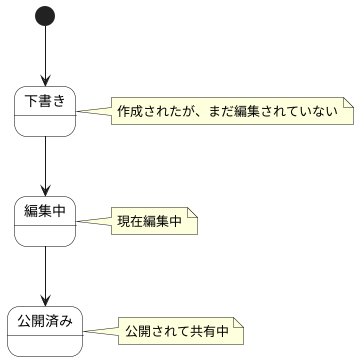

# Story Map ステートチャート

Story Map情報の状態遷移を示します。

## 状態一覧

| 状態ID | 状態名 | 説明 |
|--------|--------|------|
| ST-BL-09 | 下書き | 作成されたが、まだ編集されていない |
| ST-BL-10 | 編集中 | 現在編集中 |
| ST-BL-11 | 公開済み | 公開されて共有中 |
