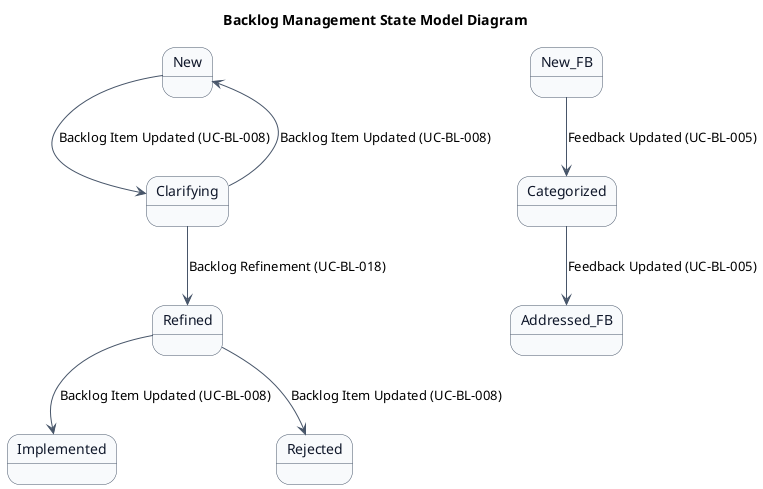
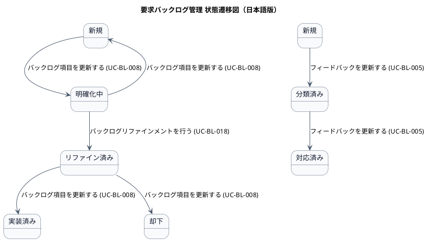

# ステートマシン図

要求バックログ管理業務領域で扱う情報の状態遷移を示す状態モデル図です。

## 1. 目的

本書は、AG-02 要求バックログ管理業務領域のシステムレイヤーで扱う情報の状態遷移を示す状態モデル図（ステートマシン図）です。

## 2. PlantUML 状態遷移図（英語版）

## 3. 日本語版 状態遷移図

## 4. 状態一覧

| 状態名 (ID)       | 英語名        | 対象情報     | 説明                                     |
|-------------------|---------------|--------------|------------------------------------------|
| 新規 (ST-BL-01)   | New           | バックログ項目 | 登録されたが、まだ明確化されていない   |
| 明確化中 (ST-BL-02) | Clarifying  | バックログ項目 | PO・開発者が内容を整理中               |
| リファイン済み (ST-BL-03) | Refined | バックログ項目 | 受入条件・分割・見積もりが整った       |
| 実装済み (ST-BL-04) | Implemented | バックログ項目 | 開発が完了し、インクリメントに含まれた |
| 却下 (ST-BL-05)   | Rejected      | バックログ項目 | 開発しないことが決定された             |
| 新規 (ST-BL-06)   | New           | フィードバック | 登録されたが、まだ分類されていない     |
| 分類済み (ST-BL-07) | Categorized | フィードバック | 種類・優先度が分類された               |
| 対応済み (ST-BL-08) | Addressed   | フィードバック | バックログ項目に変換または解決された   |

## 5. 遷移一覧

| 遷移ID | 元状態       | 遷移先状態 | トリガー                          | 関連ユースケース              | 説明                                     |
|--------|--------------|------------|-----------------------------------|-------------------------------|------------------------------------------|
| TR-BL-01 | 新規      | 明確化中   | バックログ項目を更新する (UC-BL-008) | UC-BL-008                   | 内容の明確化が開始された                 |
| TR-BL-02 | 明確化中  | 新規       | バックログ項目を更新する (UC-BL-008) | UC-BL-008                   | 明確化をキャンセルして新規に戻した       |
| TR-BL-03 | 明確化中  | リファイン済み | バックログリファインメントを行う (UC-BL-018) | UC-BL-018              | 受入条件・分割・見積もりが整った         |
| TR-BL-04 | リファイン済み | 実装済み | バックログ項目を更新する (UC-BL-008) | UC-BL-008                   | 開発が完了した                           |
| TR-BL-05 | リファイン済み | 却下     | バックログ項目を更新する (UC-BL-008) | UC-BL-008                   | 開発しないことが決定された               |
| TR-BL-06 | 新規      | 分類済み   | フィードバックを更新する (UC-BL-005) | UC-BL-005                   | 種類・優先度が分類された                 |
| TR-BL-07 | 分類済み  | 対応済み   | フィードバックを更新する (UC-BL-005) | UC-BL-005                   | バックログ項目に変換または解決された     |

## 6. 参照情報

- ステート一覧: `02.ステート/ステート一覧.tsv`
- 関連ユースケース: `03.システム境界/01.ユースケース/ユースケース一覧.md`
