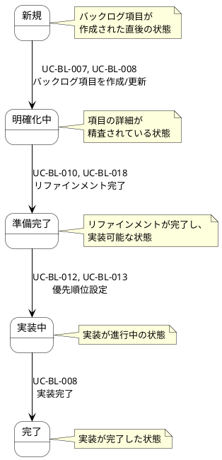

# ステートマシン図

バックログ管理の状態遷移をPlantUMLで視覚化します。

## バックログ項目の状態遷移

## 状態一覧

| 状態名 | 説明 | 遷移元 | 遷移先 | トリガーUC |
|--------|------|--------|--------|-----------|
| 新規 | 項目が作成された直後の状態 | - | 明確化中 | UC-BL-007, UC-BL-008 |
| 明確化中 | 項目の詳細が精査されている状態 | 新規 | 準備完了 | UC-BL-010, UC-BL-018 |
| 準備完了 | リファインメントが完了し、実装可能な状態 | 明確化中 | 実装中 | UC-BL-012, UC-BL-013 |
| 実装中 | 実装が進行中の状態 | 準備完了 | 完了 | UC-BL-008 |
| 完了 | 実装が完了した状態 | 実装中 | - | - |
