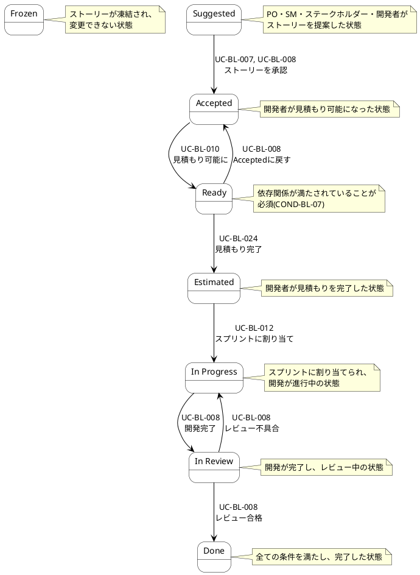

# ステートマシン図 - ストーリー

ストーリーの状態遷移をPlantUMLで視覚化します。

## 状態遷移図

## 状態一覧

| 状態名      | 説明                                                       | 遷移元      | 遷移先              | トリガーUC           |
|-------------|------------------------------------------------------------|-------------|---------------------|----------------------|
| Frozen      | ストーリーが凍結され、変更できない状態                     | -           | -                   | -                    |
| Suggested   | PO・SM・ステークホルダー・開発者がストーリーを提案した状態 | -           | Accepted            | UC-BL-007, UC-BL-008 |
| Accepted    | 開発者が見積もり可能になった状態                           | Suggested   | Ready               | UC-BL-010            |
| Ready       | 開発者が見積もりを行う準備が完了した状態                   | Accepted    | Estimated, Accepted | UC-BL-024, UC-BL-008 |
| Estimated   | 開発者が見積もりを完了した状態                             | Ready       | In Progress         | UC-BL-012            |
| In Progress | スプリントに割り当てられ、開発が進行中の状態               | Estimated   | In Review           | UC-BL-008            |
| In Review   | 開発が完了し、レビュー中の状態                             | In Progress | Done, In Progress   | UC-BL-008            |
| Done        | 全ての条件を満たし、完了した状態                           | In Review   | -                   | -                    |
