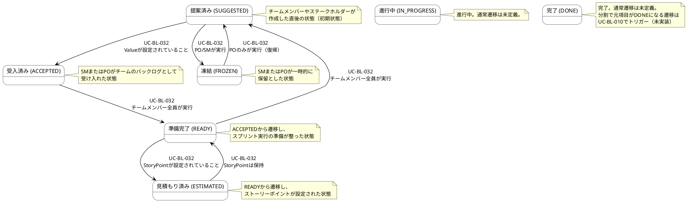

# ステートマシン図 - バックログ項目

バックログ項目の状態遷移をPlantUMLで視覚化します。

## 状態遷移図

## 状態一覧

| 状態名 | 説明 | 遷移元 | 遷移先 | トリガーUC |
|--------|------|--------|--------|------------|
| 提案済み | チームメンバーやステークホルダーが作成した直後の状態（初期状態） | - | 受入済み, 凍結 | UC-BL-032 |
| 受入済み | SMまたはPOがチームのバックログとして受け入れた状態 | 提案済み | 準備完了 | UC-BL-032 |
| 凍結 | SMまたはPOが一時的に保留とした状態 | 提案済み | 提案済み | UC-BL-032 |
| 準備完了 | ACCEPTEDから遷移し、スプリント実行の準備が整った状態 | 受入済み | 提案済み, 見積もり済み | UC-BL-032 |
| 見積もり済み | READYから遷移し、ストーリーポイントが設定された状態 | 準備完了 | 準備完了 | UC-BL-032 |
| 進行中 | 通常遷移は未定義 | - | - | - |
| 完了 | 通常遷移は未定義。分割で元項目がDONEになる遷移はUC-BL-010でトリガー（未実装） | - | - | - |
